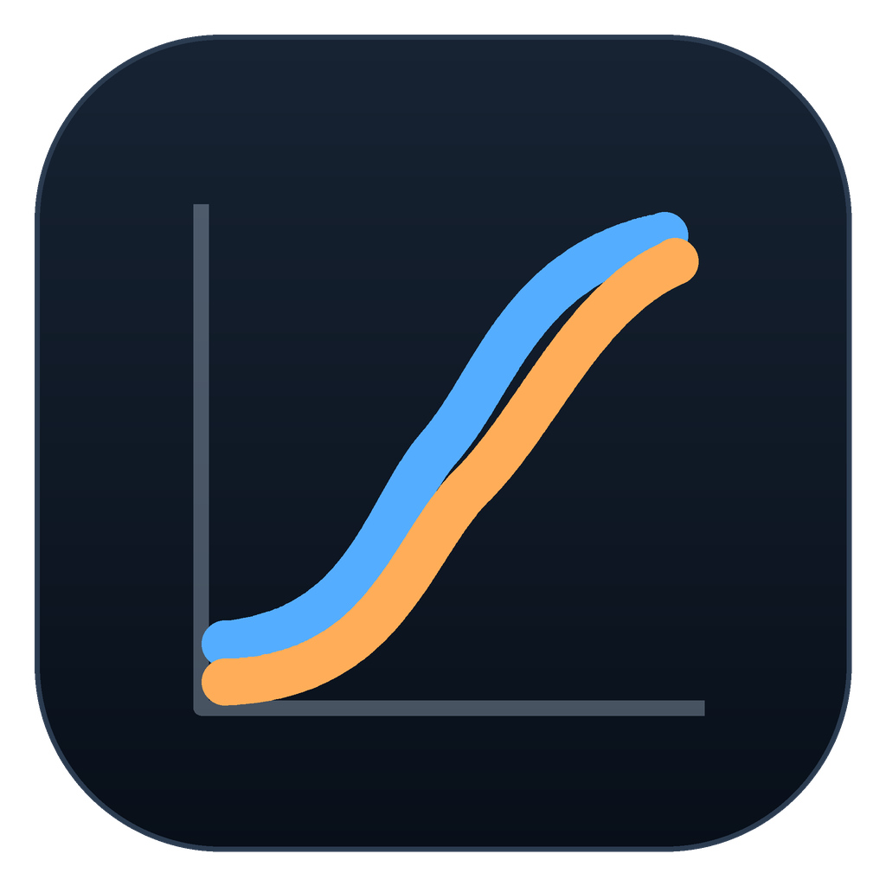
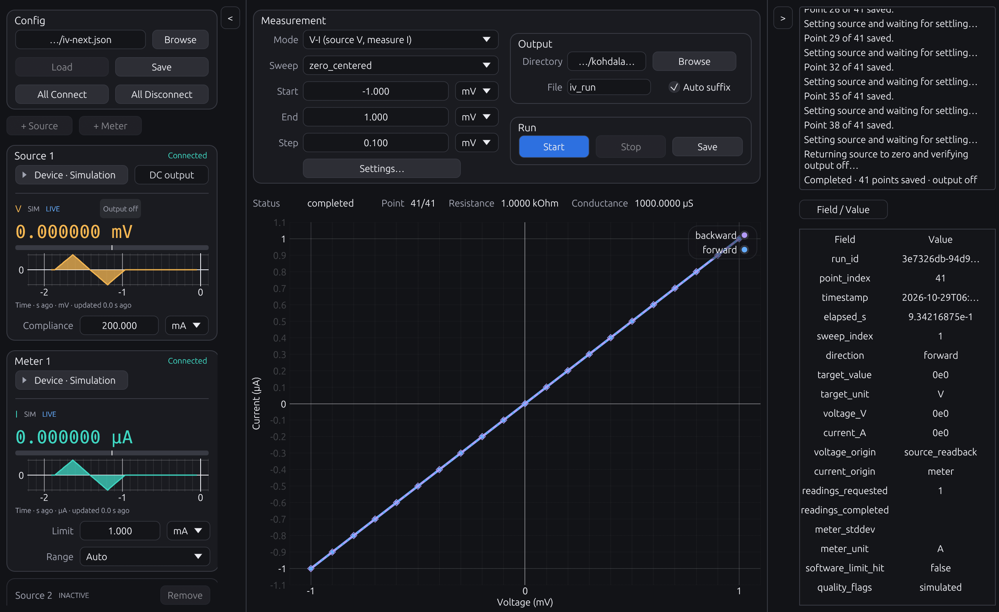
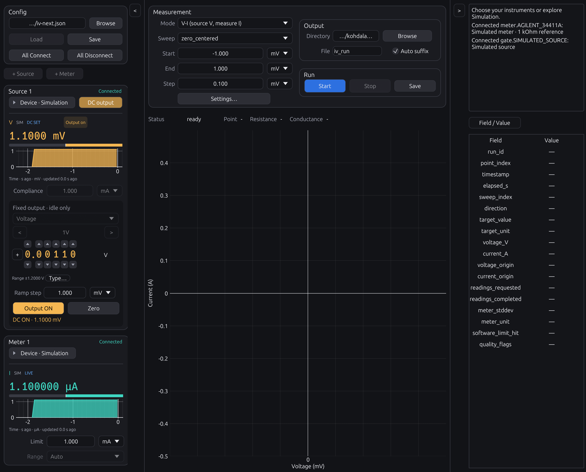
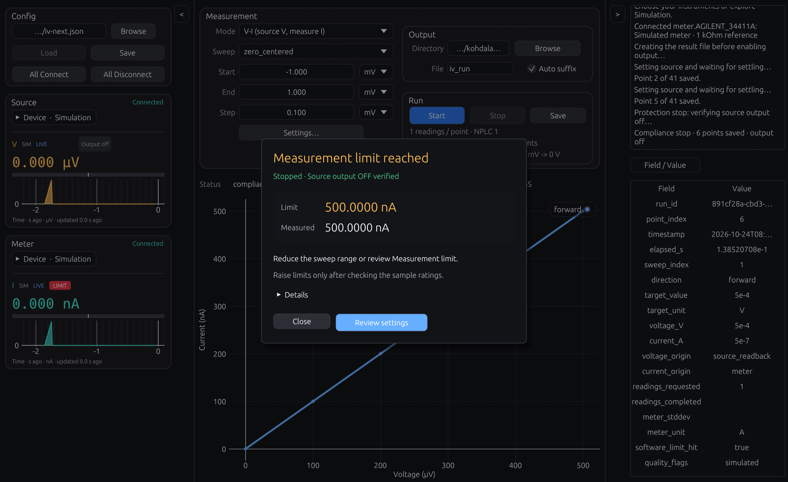

# KohdaLab IV

[](https://github.com/woolen-yarn/kohdalab-iv/actions/workflows/test.yml)
[](https://github.com/woolen-yarn/kohdalab-iv/releases/latest)
[](LICENSE)

Rust desktop application for DC I-V and V-I measurements, live source/meter monitoring, and USB/GPIB instrument control.
DC I-V・V-I 測定、ソース／メーターのライブ監視、USB/GPIB 計測器制御のための Rust デスクトップアプリケーションです。

[Download / ダウンロード](https://github.com/woolen-yarn/kohdalab-iv/releases) · [Documentation / ドキュメント](docs/README.md) · [Report an issue / 問題を報告](https://github.com/woolen-yarn/kohdalab-iv/issues)

- Voltage-source/current-measure and current-source/voltage-measure sweeps.
- Live monitoring, source protection, CSV recording, and run metadata.
- One Rust engine for the desktop GUI and optional Python/Jupyter client.

- 電圧源・電流測定、および電流源・電圧測定のスイープ。
- ライブ監視、ソース保護、CSV 記録、実行メタデータ。
- デスクトップ GUI と任意の Python/Jupyter クライアントで共通の Rust エンジン。

## Interface / 画面



Simulation example: instrument setup and live signals on the left, sweep and plot in the centre, and saved values/logs on the right.

シミュレーション例です。左に計測器の設定とライブ信号、中央にスイープとプロット、右に保存値とログを表示します。

<details>
<summary>Manual DC output / 手動DC出力</summary>



Simulation example: centre the selected range between the previous/next buttons. The range fixes the level unit and precision. Output lights when ON is verified; Zero ramps to zero while keeping ON. Range changes require OFF.

シミュレーション例です。中央のレンジを左右のボタンで選び、数値の単位と桁数はレンジに連動します。ONを確認したOutputは点灯し、ZeroはONを維持したままゼロへランプします。レンジ変更はOFF時のみ可能です。

</details>

<details>
<summary>Compliance and measurement-limit alerts / 制限到達時の表示</summary>



A stopped simulation: the popup shows the threshold, trigger reading and verified output OFF. The live monitor keeps its height and pulses a white-on-red LIMIT badge. Review settings opens the matching measurement settings; output never resumes automatically.

シミュレーション例です。上限値・トリガー値・出力OFFの確認結果を表示し、ライブ表示は高さを変えずに赤地白抜きのLIMITを点滅させます。Review settingsから設定を確認でき、出力は自動再開しません。

</details>

## Settings / 設定の保存先

IV settings use `~/.kohdalab/iv/config.json` (`%USERPROFILE%\.kohdalab\iv\config.json` on Windows). TRKR uses its own `trkr/config.json`. Old shared/preview settings are not automatically discovered or migrated; app identity checks prevent loading or overwriting another app's configuration. See [settings storage](docs/reference/settings-storage.md).

IV設定は `~/.kohdalab/iv/config.json`、TRKR設定は独立した `trkr/config.json` に保存します。旧Rust版のIV設定は元ファイルを残して初回に引き継ぎ、別アプリの設定を読み込み・上書きする操作は拒否します。[設定の保存先](docs/reference/settings-storage.md)を参照してください。

## Downloads / ダウンロード

| Channel / 配布チャネル | Version / バージョン | Platforms / 対応プラットフォーム |
| --- | --- | --- |
| Stable / 安定版 | [1.2.0](https://github.com/woolen-yarn/kohdalab-iv/releases/tag/portable-v1.2.0) | Windows x64 Setup / portable ZIP; macOS Apple silicon portable ZIP / Windows x64 セットアップ・ポータブル ZIP、macOS Apple silicon ポータブル ZIP |
| Preview / プレビュー | [1.3.0-alpha.16](https://github.com/woolen-yarn/kohdalab-iv/releases/tag/preview-v1.3.0-alpha.16) | Windows x64 Setup / preview ZIP; macOS Apple silicon preview ZIP / Windows x64 セットアップ・プレビュー ZIP、macOS Apple silicon プレビュー ZIP |

| Preview package / プレビューパッケージ | Kohdalab | Personal / 個人ミラー |
| --- | --- | --- |
| Windows Setup | [Download](https://github.com/Kohdalab/kohdalab-iv/releases/download/preview-v1.3.0-alpha.16/kohdalab-iv-1.3.0-alpha.16-windows-x64-Setup.exe) | [Download](https://github.com/woolen-yarn/kohdalab-iv/releases/download/preview-v1.3.0-alpha.16/kohdalab-iv-1.3.0-alpha.16-windows-x64-Setup.exe) |
| Windows portable | [Download](https://github.com/Kohdalab/kohdalab-iv/releases/download/preview-v1.3.0-alpha.16/kohdalab-iv-1.3.0-alpha.16-windows-x64-preview.zip) | [Download](https://github.com/woolen-yarn/kohdalab-iv/releases/download/preview-v1.3.0-alpha.16/kohdalab-iv-1.3.0-alpha.16-windows-x64-preview.zip) |
| Mac portable (Apple silicon) | [Download](https://github.com/Kohdalab/kohdalab-iv/releases/download/preview-v1.3.0-alpha.16/kohdalab-iv-1.3.0-alpha.16-macos-arm64-preview.zip) | [Download](https://github.com/woolen-yarn/kohdalab-iv/releases/download/preview-v1.3.0-alpha.16/kohdalab-iv-1.3.0-alpha.16-macos-arm64-preview.zip) |
| Source build kit / ソースビルドキット | [Download](https://github.com/Kohdalab/kohdalab-iv/releases/download/preview-v1.3.0-alpha.16/kohdalab-iv-1.3.0-alpha.16-build-kit.zip) | [Download](https://github.com/woolen-yarn/kohdalab-iv/releases/download/preview-v1.3.0-alpha.16/kohdalab-iv-1.3.0-alpha.16-build-kit.zip) |

Rust and Python are not required to run the packaged application. Current Windows
artifacts are unsigned; download packages and checksums together from Releases.
macOS bundles use ad hoc signing and are not Apple-notarized.

配布アプリケーションの実行に Rust や Python は不要です。現在の Windows 配布物は未署名です。Releases からパッケージとチェックサムを必ず一緒に取得してください。macOS バンドルは ad hoc 署名であり、Apple の公証は受けていません。

Preview 1.3.0-alpha.16 makes manual DC range selection explicit: use the central range selector and its left/right arrows to choose a documented native range before Output. The Source card then keeps a fixed, range-derived V/mV/mA display unit and precision; Output and Zero are equal-width controls. Device → live → settings remains the compact Source/Meter workflow. Meter transition protection, CSV columns, and existing output safety remain unchanged. See [manual DC operation](docs/reference/manual-dc-output.md), [meter ranging](docs/reference/meter-ranging.md), and [alpha.16 validation](docs/validation/manual-dc-alpha16.md).

Preview 1.3.0-alpha.16では、手動DCのレンジを明示的に選択します。中央のレンジ選択と左右矢印で、出力前に対応するネイティブレンジを選びます。Sourceカードは選択レンジに基づく固定のV/mV/mA表示と桁数を維持し、OutputとZeroは同じ幅です。Source／MeterはDevice → live → settingsのコンパクトな流れを維持します。メーターのレンジ遷移保護、CSV列、既存の出力安全機能は変更しません。[手動DC操作](docs/reference/manual-dc-output.md)、[メーターレンジ](docs/reference/meter-ranging.md)、[alpha.16検証](docs/validation/manual-dc-alpha16.md)を参照してください。

## Supported hardware / 対応機器

| Role / 役割 | Model / API identifier / モデル・API 識別子 | Availability / 対応状況 |
| --- | --- | --- |
| Source / ソース | Yokogawa GS210 · `YOKOGAWA_GS210` | Stable + preview / 安定版・プレビュー |
| Source / ソース | Yokogawa 7651 · `YOKOGAWA_7651` | Preview; physical validation pending / プレビュー。実機検証待ち |
| Meter / メーター | Agilent / Keysight 34411A · `AGILENT_34411A`, `KEYSIGHT_34411A` | Stable + preview / 安定版・プレビュー |
| Meter / メーター | Agilent 34401A · `AGILENT_34401A` | Preview; physical validation pending / プレビュー。実機検証待ち |
| Meter / メーター | Keysight 34465A · `KEYSIGHT_34465A` | Preview; physical validation pending / プレビュー。実機検証待ち |
| Meter / メーター | ADCMT 7461A · `ADCMT_7461A` | Preview; physical validation pending / プレビュー。実機検証待ち |
| Simulation / シミュレーション | `SIMULATED_SOURCE`, `SIMULATED_METER` | Built in / 内蔵 |

See [hardware and transport](docs/reference/hardware.md) for USB/USBTMC/GPIB, official VISA, adapter requirements, and model limitations. Stable downloads do not include the additional preview drivers.

USB/USBTMC/GPIB、公式 VISA、アダプター要件、モデルごとの制約は[ハードウェアと転送](docs/reference/hardware.md)を参照してください。安定版のダウンロードには、プレビュー版用の追加ドライバーは含まれません。

## Quick start / はじめに

1. Choose the stable release or explicitly opt into the preview. Install Setup or extract the complete portable package.
2. Start with the simulated source and meter to explore the interface.
3. Review source/meter identities, connection routes, ranges, and protection settings before connecting a load.
4. Choose a sweep and output location, then Start. Monitoring and mode selection do not enable source output.

1. 安定版を選ぶか、明示的にプレビュー版を選択します。セットアップを実行するか、ポータブルパッケージ一式を展開します。
2. まずシミュレーションのソースとメーターで、インターフェースを確認します。
3. 負荷を接続する前に、ソース／メーターの識別、接続経路、レンジ、保護設定を確認します。
4. スイープと出力先を選んで Start を押します。監視とモード選択だけではソース出力は有効になりません。

Manual fixed output: [DC source controls](docs/reference/manual-dc-output.md).

Python/Jupyter access: [client guide](bindings/python/README.md). Detailed measurement semantics: [application guide](docs/guides/application-guide.md).

Python・Jupyter からの利用は[クライアントガイド](bindings/python/README.md)、詳細な測定仕様は[アプリケーションガイド](docs/guides/application-guide.md)を参照してください。

## Sweep planning and protection / スイープと保護

Sweep paths use the entered endpoints: `linear` follows Start → End,
`round_trip` follows Start → End → Start, and `zero_centered` follows
0 → End → Start → 0. Zero-centered sweeps require zero inside the interval
(or at either endpoint); they never mirror an endpoint to the opposite sign.
For example, Start −1.6 mV and End 0 mV gives 0 → −1.6 → 0 mV.
Use linear or round_trip for an interval entirely above or below zero.
Each segment reaches its exact endpoint; its last interval may be shorter than
Step. Custom points retain their entered order, including duplicates.
The Run preview shows the effective Step, rounding, point count and route.

スイープは入力した端点を使います。`linear` は Start → End、`round_trip` は
Start → End → Start、`zero_centered` は 0 → End → Start → 0 の順です。
ゼロ中心は区間内または端点にゼロを含む必要があり、入力値を反対符号へ反転しません。
Start −1.6 mV・End 0 mV なら 0 → −1.6 → 0 mV です。
ゼロを含まない区間では linear または round_trip を使ってください。
各区間は端点に正確に到達し、最後の間隔だけ Step より短くなる場合があります。
Custom は重複を含めて入力順を保持します。Run のプレビューには実効 Step・丸め・点数・経路を表示します。

Active-sweep protection checks every acquired meter reading, including live
readings during ramps and settling. On software compliance, source OFF is
requested before further instrument queries or saving; protection cleanup does
not ramp with output enabled. Normal Stop still returns to zero before OFF.
GS210 hardware H/L protection is checked separately from the external Meter
software stop, including zero-wait ramps; a limited target is kept as raw evidence
and excluded from analysis. The Source and Meter cards separate Source compliance
from Meter limit; the Source compliance tooltip shows effective hardware protection.
The left-panel Meter card’s **Meter range** control selects Auto or a fixed voltage/current range,
held through the whole return sweep. See [meter ranging](docs/reference/meter-ranging.md)
for supported models and protection behavior.
Before enabling output, the engine verifies source function, programmed range,
zero setting and output ON. This common policy covers both supported sources
and every supported meter. See [safety notes](SAFETY.md) for limits.

実行中はランプ・待機中のライブ測定も含め、取得した各読み値を保護判定します。
ソフトウェア制限に達した場合は、追加の機器照会や保存より先に出力 OFF を要求し、
出力を入れたまま終了ランプを実行しません。通常の Stop はゼロへ戻してから OFF にします。
出力開始時は機能・設定レンジ・ゼロ設定・ON 状態を確認します。
この共通処理を対応する両ソースと全メーターに適用します。制約は[安全上の注意](SAFETY.md)を参照してください。

## Development / 開発

Run commands from the repository root. The root `Cargo.toml` and `Cargo.lock`
are the workspace entry point; product packages live under `crates/`.

リポジトリのルートからコマンドを実行します。ルートの `Cargo.toml` と `Cargo.lock` がワークスペースの入口で、製品パッケージは `crates/` にあります。

```sh
cargo fmt --all --check
cargo test --workspace --locked
cargo build --release --locked
cargo run --locked --bin kohdalab-iv
```

```text
crates/       Rust desktop, measurement core, and transport
bindings/     Thin Python/Jupyter client
native/       Isolated native helpers and upstream notices
packaging/    Windows installer and driver-setup assets
scripts/      Build, package, and validation entry points
specs/        Reviewed instrument profiles and measurement specifications
tests/        Packaging and distribution-policy tests
docs/         Guides, development notes, references, validation, images
```

ディレクトリの役割は、`crates/`（Rust デスクトップ、測定コア、転送）、`bindings/`（薄い Python/Jupyter クライアント）、`native/`（分離されたネイティブヘルパーと上流通知）、`packaging/`（Windows インストーラーとドライバー設定資産）、`scripts/`（ビルド・パッケージ・検証の入口）、`specs/`（レビュー済み計測器プロファイルと測定仕様）、`tests/`（パッケージングと配布ポリシーのテスト）、`docs/`（ガイド、開発ノート、参照資料、検証、画像）です。

See [repository layout](docs/development/repository-layout.md) and
[CONTRIBUTING.md](CONTRIBUTING.md) before changing device or build boundaries.
Tests must not connect hardware, move stages, enable outputs, or alter drivers.

デバイス境界やビルド境界を変更する前に、[リポジトリ構成](docs/development/repository-layout.md)と [CONTRIBUTING.md](CONTRIBUTING.md) を確認してください。テストでハードウェア接続、出力有効化、ドライバー変更を行ってはいけません。

## Documentation / ドキュメント

- [Documentation index](docs/README.md): the entry point for all guides and references.
- `docs/guides/`: installation and everyday operation.
- `docs/development/`: architecture, extension points, and build/release maintenance.
- `docs/reference/`: hardware, protocols, formats, and compatibility contracts.
- `docs/validation/`: versioned evidence and measured limitations.
- `docs/images/`: repository screenshots and figures.

- [ドキュメント一覧](docs/README.md)：すべてのガイドと参照資料の入口。
- `docs/guides/`：インストールと日常の操作。
- `docs/development/`：アーキテクチャ、拡張点、ビルド／リリース保守。
- `docs/reference/`：ハードウェア、プロトコル、形式、互換性契約。
- `docs/validation/`：バージョン管理された証跡と計測上の制約。
- `docs/images/`：リポジトリのスクリーンショットと図。

## KohdaLab applications / KohdaLabのアプリケーション

[IV](https://github.com/woolen-yarn/kohdalab-iv) · [TRKR](https://github.com/woolen-yarn/kohdalab-trkr) · [Camera](https://github.com/woolen-yarn/kohdalab-camera)

The applications share a root Cargo workspace, `crates/` source packages, focused
build scripts, and the same documentation categories. Hardware backends and
qualification remain product-specific.

これらのアプリケーションは、ルート Cargo ワークスペース、`crates/` のソースパッケージ、目的別ビルドスクリプト、共通のドキュメント分類を共有しています。ハードウェアバックエンドと認定は製品ごとに異なります。

## License / ライセンス

Project code is [MIT licensed](LICENSE). Native helpers and redistributed
dependencies retain their own licenses; keep the accompanying notices and source.
See [redistribution terms](REDISTRIBUTION.md), [code signing](CODE_SIGNING_POLICY.md), and [privacy](PRIVACY.md).

プロジェクトコードは [MIT ライセンス](LICENSE)です。ネイティブヘルパーと再配布する依存関係にはそれぞれのライセンスが適用されるため、付属の通知とソースを保持してください。[再配布条件](REDISTRIBUTION.md)、[コード署名](CODE_SIGNING_POLICY.md)、[プライバシー](PRIVACY.md)も参照してください。

Preview: [Dual source and control of the open GUI](docs/reference/dual-source-and-gui-control.md).

Preview GUI automation: [common API and ownership contract](docs/reference/gui-api.md).

### Python stop policy / Pythonの停止条件

The GUI API now shares independently selectable stop conditions, typed exceptions and `stop_and_wait()` with TRKR. IV retains fail-safe defaults and normal close/release verifies Output OFF. See [usage and stop conditions (English/Japanese)](bindings/python/README.md#gui-stop-conditions--guiの停止条件).

TRKRと共通の停止条件選択・例外分類・停止完了待ちを追加しました。IVは保護を既定とし、正常終了時のOutput OFF確認を維持します。[英日利用ガイド](bindings/python/README.md#gui-stop-conditions--guiの停止条件)を参照してください。
