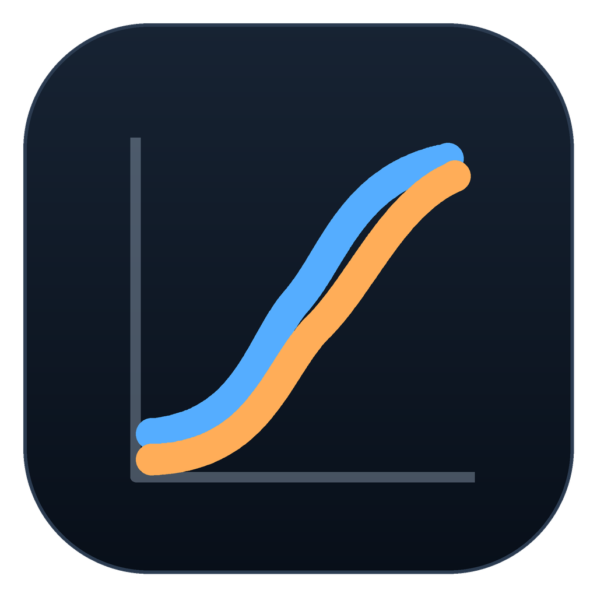
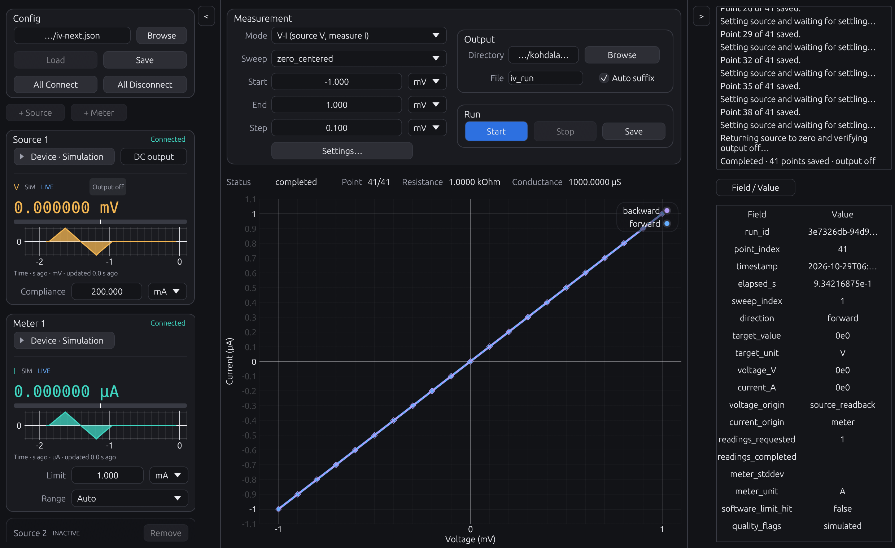
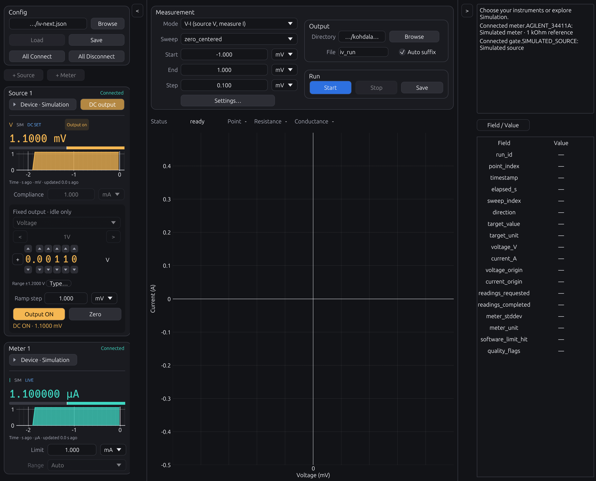
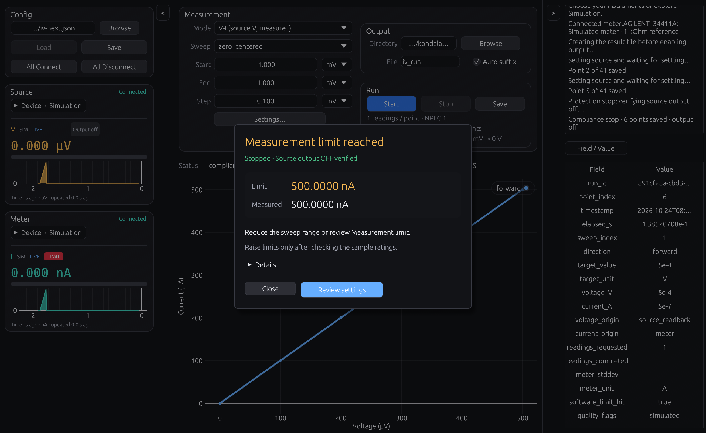

# KohdaLab IV

[](https://github.com/woolen-yarn/kohdalab-iv/actions/workflows/test.yml)
[](https://github.com/woolen-yarn/kohdalab-iv/releases/latest)
[](LICENSE)

Rust desktop application for DC I-V and V-I measurements, live source/meter monitoring, and USB/GPIB instrument control.
DC I-V・V-I 測定、ソース／メーターのライブ監視、USB/GPIB 計測器制御のための Rust デスクトップアプリケーションです。

[Download / ダウンロード](https://github.com/woolen-yarn/kohdalab-iv/releases) · [Documentation / ドキュメント](docs/README.md) · [Report an issue / 問題を報告](https://github.com/woolen-yarn/kohdalab-iv/issues)

- Voltage-source/current-measure and current-source/voltage-measure sweeps.
- Live monitoring, source protection, and a four-file measurement bundle (analysis CSV, raw CSV, lifecycle log, conditions manifest).
- One Rust engine for the desktop GUI and optional Python/Jupyter client.

- 電圧源・電流測定、および電流源・電圧測定のスイープ。
- ライブ監視、ソース保護、解析CSV・raw CSV・ライフサイクルlog・条件manifestの4ファイル測定bundle。
- デスクトップ GUI と任意の Python/Jupyter クライアントで共通の Rust エンジン。

[Try without hardware / 機器なしで試す](docs/guides/quick-start.md) · [Hardware and connections / 機器と接続](docs/reference/hardware.md) · [Python and API / PythonとAPI](docs/reference/common-control-api.md)

## Interface / 画面



macOS simulation screenshot of 1.4.0 (2× scale; device-free GUI verification): instrument setup and live signals are on the left, sweep and plot are in the centre, and saved values/logs are on the right. The release keeps the same layout; the final package version is shown in its title bar.

1.4.0のmacOSシミュレーション画面（2×スケール、実機を使わないGUI検証）です。左に計測器の設定とライブ信号、中央にスイープとプロット、右に保存値とログを表示します。リリース版も同じレイアウトで、最終パッケージの版番号はタイトルバーに表示されます。

### Source and measured values / Source値と実測値

In Settings, assign the Source, required opposite-quantity Meter, and optional same-quantity **Meter (V)** / **Meter (I)**. The optional Meter is a voltage Meter for V-I and Dual V-I, or a current Meter for I-V. The central plot keeps one shared SI coordinate system: the lower axis is the Source quantity and the reserved upper axis is the optional Meter quantity, so the plot does not move when that Meter is absent. Source- and Meter-based traces overlay; the legend identifies only `forward` and `backward`. The one-line status strip shows independent Source and Meter fitted resistance/conductance, while CSV records per-point ratios separately. Missing measurements remain blank rather than being inferred from a source setting. See [source and meter values](docs/guides/source-and-meter-values.md) and the [CSV contract](docs/reference/csv-format.md).

Settingsでは、Source、反対量を測る必須Meter、同じ物理量を測る任意の **Meter (V)** / **Meter (I)** を割り当てます。任意MeterはV-I／Dual V-Iでは電圧Meter、I-Vでは電流Meterです。中央プロットは同じSIスケールを共有し、下軸はSource、上軸は任意Meterです。任意Meterがなくても上軸領域を保持するため、グラフ位置は変わりません。Source/Meter由来の線を重ね、凡例は `forward` と `backward` のみを示します。1行のstatusにはSource/Meter別の掃引フィットによる抵抗・コンダクタンスを表示し、CSVには点ごとの比を別に保存します。取得できない実測値をSource設定値から推定して埋めることはありません。[Source/Meter値](docs/guides/source-and-meter-values.md)と[CSV仕様](docs/reference/csv-format.md)を参照してください。

### Recording durability / 記録の耐久性

Before output is enabled, IV creates the analysis CSV, raw audit CSV, and initial run metadata without replacing existing names; a collision aborts the run and keeps the earlier file. Startup errors also retain partial files; retry with a new output name. After output cleanup, both CSV streams are flushed and `sync_all` is requested before checksums and final outcome metadata are written. A synchronization failure marks the recording failed and preserves the partial files for review. This is an operating-system persistence request, not a universal guarantee against sudden power loss or a per-point crash journal.

出力ON前に、IVは解析CSV・raw監査CSV・初期run metadataを既存ファイルを置換せずに作成します。同名ファイルとの衝突時は実行を中止し、先行ファイルを保持します。開始失敗時の部分ファイルも残すため、再試行時は新しい出力名を使用してください。出力後処理後、両CSVをflushして`sync_all`を要求してから、チェックサムと最終結果metadataを書き込みます。同期に失敗した場合は記録を失敗として扱い、調査用に部分ファイルを残します。これはOSへの永続化要求であり、突然の電源断に対する万能な保証や点ごとのクラッシュジャーナルではありません。

<details>
<summary>Manual DC output / 手動DC出力</summary>



Simulation example: centre the selected range between the previous/next buttons. The range fixes the level unit and precision. Output lights when ON is verified; Zero ramps to zero while keeping ON. Range changes require OFF.

シミュレーション例です。中央のレンジを左右のボタンで選び、数値の単位と桁数はレンジに連動します。ONを確認したOutputは点灯し、ZeroはONを維持したままゼロへランプします。レンジ変更はOFF時のみ可能です。

</details>

<details>
<summary>Compliance and measurement-limit alerts / 制限到達時の表示</summary>



A stopped simulation: the popup shows the threshold, trigger reading and verified output OFF. The live monitor keeps its height and pulses a white-on-red LIMIT badge. Review settings opens the matching measurement settings; output never resumes automatically.

シミュレーション例です。上限値・トリガー値・出力OFFの確認結果を表示し、ライブ表示は高さを変えずに赤地白抜きのLIMITを点滅させます。Review settingsから設定を確認でき、出力は自動再開しません。

</details>

## Settings / 設定の保存先

On first normal GUI launch, IV atomically creates its missing default configuration without connecting instruments or enabling output. Existing files are preserved; invalid/unsupported profiles produce an error instead of being replaced. Explicit profiles and smoke tests do not initialize the production default. IV settings use `~/.kohdalab/iv/config/config.json` (`%USERPROFILE%\.kohdalab\iv\config\config.json` on Windows). TRKR uses its own `trkr/config/config.json`. Old shared/preview settings are not automatically discovered or migrated; app identity checks prevent loading or overwriting another app's configuration. See [settings storage](docs/reference/settings-storage.md).

初回の通常GUI起動時に、標準設定ファイルが存在しなければ自動作成します。既存ファイルは保持し、不正・未対応の設定は置き換えずエラーを表示します。設定の作成・読込による装置接続や出力ONは行いません。明示的なプロファイル指定・スモークテスト時は通常用設定を作成しません。IV設定は `~/.kohdalab/iv/config/config.json`、TRKR設定は独立した `trkr/config/config.json` に保存します。旧共有設定や `next.json` は自動探索・移行せず、既存ファイルを残します。別アプリの設定を読み込み・上書きする操作は拒否します。[設定の保存先](docs/reference/settings-storage.md)を参照してください。

## Downloads / ダウンロード

| OS | Installer / インストーラー | Portable / ポータブル |
| --- | --- | --- |
| Windows x64 | Setup EXE | ZIP |
| macOS Apple silicon | DMG（Applicationsへコピー） | App ZIP |
| Linux | 配布準備中 / Pending | 配布準備中 / Pending |

Download the four packages and SHA-256 checksums from [v1.0.0 Releases](https://github.com/woolen-yarn/kohdalab-iv/releases/tag/v1.0.0). Windows Setup is unsigned. macOS uses ad hoc signing and is not notarized.

[v1.0.0 Releases](https://github.com/woolen-yarn/kohdalab-iv/releases/tag/v1.0.0) から配布物とSHA-256を取得できます。Windows Setupは未署名、macOSはad hoc署名・未公証です。

## Hardware / 対応機器

| Model / 機器 | Role · model ID / 役割・モデルID | Physical connection verified on Windows / Windowsで実機確認した接続 |
| --- | --- | --- |
| Yokogawa GS210 | Source · `YOKOGAWA_GS210` | GPIB / VISA, USBTMC / VISA |
| Yokogawa 7651 | Source · `YOKOGAWA_7651` | GPIB / VISA |
| Agilent 34401A | Meter · `AGILENT_34401A` | GPIB / VISA |
| ADCMT 7461A | Meter · `ADCMT_7461A` | GPIB / VISA |
| Keysight 34465A | Meter · `KEYSIGHT_34465A` | USBTMC / VISA |
| Agilent / Keysight 34411A | Meter · `AGILENT_34411A`, `KEYSIGHT_34411A` | GPIB / VISA, USBTMC / VISA |
| Simulated source / シミュレーション | Source · `SIMULATED_SOURCE` | Simulation only / シミュレーションのみ |
| Simulated meter / シミュレーション | Meter · `SIMULATED_METER` | Simulation only / シミュレーションのみ |

The hardware routes in the table were exercised during Windows commissioning. The model IDs are used with both IV and VI plans. Model IDs are the values stored in settings and used by the Python client; the 34411A has Agilent and Keysight IDs for the same hardware. Simulated models need no hardware or VISA. Select the detected resource in **Device → Refresh** with the manufacturer's 64-bit VISA installed. See [test scope and package qualification](docs/validation-v1-candidate.md) and [hardware setup](docs/reference/hardware.md).

表の実機接続経路はWindowsで確認しました。モデルIDはIV・VIの測定計画で使用します。モデルIDは設定ファイルとPythonクライアントで使う値で、34411AはAgilent・Keysightの両IDが同一機種を指します。シミュレーション機種は機器・VISAを必要としません。メーカーの64-bit VISAを使用し、**Device → Refresh** で対象を選びます。試験範囲は[検証表](docs/validation-v1-candidate.md)、接続手順は[ハードウェア設定](docs/reference/hardware.md)を参照してください。

## Quick start / はじめに

1. Install the stable release with Setup or extract the complete portable package.
2. Start with the simulated source and meter to explore the interface.
3. Review source/meter identities, connection routes, ranges, and protection settings before connecting a load.
4. Choose a sweep and output location, then Start. Monitoring and mode selection do not enable source output.

1. 安定版のセットアップを実行するか、ポータブルパッケージ一式を展開します。
2. まずシミュレーションのソースとメーターで、インターフェースを確認します。
3. 負荷を接続する前に、ソース／メーターの識別、接続経路、レンジ、保護設定を確認します。
4. スイープと出力先を選んで Start を押します。監視とモード選択だけではソース出力は有効になりません。

Manual fixed output / 手動固定出力 · [DC source controls / DCソース操作](docs/reference/manual-dc-output.md).

Python/Jupyter access: [client guide](bindings/python/README.md). Detailed measurement semantics: [application guide](docs/guides/application-guide.md).

Python・Jupyter からの利用は[クライアントガイド](bindings/python/README.md)、詳細な測定仕様は[アプリケーションガイド](docs/guides/application-guide.md)を参照してください。

## Sweep planning and protection / スイープと保護

Sweep paths use the entered endpoints: `linear` follows Start → End,
`round_trip` follows Start → End → Start, and `zero_centered` follows
0 → End → Start → 0. Zero-centered sweeps require zero inside the interval
(or at either endpoint); they never mirror an endpoint to the opposite sign.
For example, Start −1.6 mV and End 0 mV gives 0 → −1.6 → 0 mV.
Use linear or round_trip for an interval entirely above or below zero.
Each segment reaches its exact endpoint; its last interval may be shorter than
Step. Custom points retain their entered order, including duplicates.
The Run preview shows the effective Step, rounding, point count and route.

スイープは入力した端点を使います。`linear` は Start → End、`round_trip` は
Start → End → Start、`zero_centered` は 0 → End → Start → 0 の順です。
ゼロ中心は区間内または端点にゼロを含む必要があり、入力値を反対符号へ反転しません。
Start −1.6 mV・End 0 mV なら 0 → −1.6 → 0 mV です。
ゼロを含まない区間では linear または round_trip を使ってください。
各区間は端点に正確に到達し、最後の間隔だけ Step より短くなる場合があります。
Custom は重複を含めて入力順を保持します。Run のプレビューには実効 Step・丸め・点数・経路を表示します。

Active-sweep protection checks every acquired meter reading, including live
readings during ramps and settling. On software compliance, source OFF is
requested before further instrument queries or saving; protection cleanup does
not ramp with output enabled. Normal Stop still returns to zero before OFF.
GS210 hardware H/L protection is checked separately from the external Meter
software stop, including zero-wait ramps; a limited target is kept as raw evidence
and excluded from analysis. The Source and Meter cards separate Source compliance
from Meter limit; the Source compliance tooltip shows effective hardware protection.
The left-panel Meter card’s **Meter range** control selects Auto or a fixed voltage/current range,
held through the whole return sweep. See [meter ranging](docs/reference/meter-ranging.md)
for supported models and protection behavior.
Before enabling output, the engine verifies source function, programmed range,
zero setting and output ON. This common policy covers both supported sources
and every supported meter. See [safety notes](SAFETY.md) for limits.

実行中はランプ・待機中のライブ測定も含め、取得した各読み値を保護判定します。
ソフトウェア制限に達した場合は、追加の機器照会や保存より先に出力 OFF を要求し、
出力を入れたまま終了ランプを実行しません。通常の Stop はゼロへ戻してから OFF にします。
出力開始時は機能・設定レンジ・ゼロ設定・ON 状態を確認します。
この共通処理を対応する両ソースと全メーターに適用します。制約は[安全上の注意](SAFETY.md)を参照してください。

## Development / 開発

Run commands from the repository root. The root `Cargo.toml` and `Cargo.lock`
are the workspace entry point; product packages live under `crates/`.

リポジトリのルートからコマンドを実行します。ルートの `Cargo.toml` と `Cargo.lock` がワークスペースの入口で、製品パッケージは `crates/` にあります。

```sh
cargo fmt --all --check
cargo test --workspace --locked
cargo build --release --locked
cargo run --locked --bin kohdalab-iv
```

```text
crates/       Rust desktop, measurement core, and transport
bindings/     Thin Python/Jupyter client
native/       Isolated native helpers and upstream notices
packaging/    Windows installer and driver-setup assets
scripts/      Build, package, and validation entry points
specs/        Reviewed instrument profiles and measurement specifications
tests/        Packaging and distribution-policy tests
docs/         Guides, development notes, references, validation, images
```

ディレクトリの役割は、`crates/`（Rust デスクトップ、測定コア、転送）、`bindings/`（薄い Python/Jupyter クライアント）、`native/`（分離されたネイティブヘルパーと上流通知）、`packaging/`（Windows インストーラーとドライバー設定資産）、`scripts/`（ビルド・パッケージ・検証の入口）、`specs/`（レビュー済み計測器プロファイルと測定仕様）、`tests/`（パッケージングと配布ポリシーのテスト）、`docs/`（ガイド、開発ノート、参照資料、検証、画像）です。

See [repository layout](docs/development/repository-layout.md) and
[CONTRIBUTING.md](CONTRIBUTING.md) before changing device or build boundaries.
Tests must not connect hardware, move stages, enable outputs, or alter drivers.

デバイス境界やビルド境界を変更する前に、[リポジトリ構成](docs/development/repository-layout.md)と [CONTRIBUTING.md](CONTRIBUTING.md) を確認してください。テストでハードウェア接続、出力有効化、ドライバー変更を行ってはいけません。

## Documentation / ドキュメント

- [Documentation index](docs/README.md): the entry point for all guides and references.
- [Measurement output bundles](docs/reference/measurement-output.md): common file roles and unit conventions.
- `docs/guides/`: installation and everyday operation.
- `docs/development/`: architecture, extension points, and build/release maintenance.
- `docs/reference/`: hardware, protocols, formats, and compatibility contracts.
- `docs/validation/`: versioned evidence and measured limitations.
- `docs/images/`: repository screenshots and figures.

- [ドキュメント一覧](docs/README.md)：すべてのガイドと参照資料の入口。
- [測定データの保存セット](docs/reference/measurement-output.md)：共通のファイル構成と単位の規約。
- `docs/guides/`：インストールと日常の操作。
- `docs/development/`：アーキテクチャ、拡張点、ビルド／リリース保守。
- `docs/reference/`：ハードウェア、プロトコル、形式、互換性契約。
- `docs/validation/`：バージョン管理された証跡と計測上の制約。
- `docs/images/`：リポジトリのスクリーンショットと図。

## Common GUI control / 共通GUI制御

- [Dual source and control of the open GUI / 2ソースと起動中のGUI制御](docs/reference/dual-source-and-gui-control.md)
- [GUI API and ownership contract / GUI APIと所有権](docs/reference/gui-api.md)

### Python stop policy / Pythonの停止条件

The GUI API now shares independently selectable stop conditions, typed exceptions and `stop_and_wait()` with TRKR. IV retains fail-safe defaults and normal close/release verifies Output OFF. See [usage and stop conditions (English/Japanese)](bindings/python/README.md#gui-stop-conditions--guiの停止条件).

TRKRと共通の停止条件選択・例外分類・停止完了待ちを追加しました。IVは保護を既定とし、正常終了時のOutput OFF確認を維持します。[英日利用ガイド](bindings/python/README.md#gui-stop-conditions--guiの停止条件)を参照してください。

[Control Protocol 1 and Python/Notebook examples / 共通APIとPython・Notebook](docs/reference/common-control-api.md). The existing application API remains supported; operation payloads and safety policy are app-specific. Camera is read-only. / 既存APIは維持し、操作引数と安全方針は各アプリに従います。Cameraは読み取り専用です。

### Batch connections / 一括接続

All Connect keeps attempting the remaining assigned instruments after a device configuration or connection error. The combined engine command and GUI API also retain successful connections and report partial failures after the attempts. Stop and protection failures still take priority; source outputs are not enabled by connecting. Existing profiles and CSV formats remain compatible.

All Connectは設定不良・接続失敗があっても残りの割当機器を試します。内部一括命令とGUI APIも成功した接続を保持し、試行後に一部失敗を報告します。Stop・保護異常は引き続き優先し、接続でSource出力をONにはしません。既存設定・CSV形式の互換性は維持します。

## KohdaLab applications / KohdaLabのアプリケーション

[IV](https://github.com/woolen-yarn/kohdalab-iv) · [TRKR](https://github.com/woolen-yarn/kohdalab-trkr) · [Camera](https://github.com/woolen-yarn/kohdalab-camera)

The applications share a root Cargo workspace, `crates/` source packages, focused
build scripts, and the same documentation categories. Hardware backends and
qualification remain product-specific.

これらのアプリケーションは、ルート Cargo ワークスペース、`crates/` のソースパッケージ、目的別ビルドスクリプト、共通のドキュメント分類を共有しています。ハードウェアバックエンドと認定は製品ごとに異なります。

## License / ライセンス

Project code is [MIT licensed](LICENSE). Native helpers and redistributed
dependencies retain their own licenses; keep the accompanying notices and source.
See [redistribution terms](REDISTRIBUTION.md), [code signing](CODE_SIGNING_POLICY.md), and [privacy](PRIVACY.md).

プロジェクトコードは [MIT ライセンス](LICENSE)です。ネイティブヘルパーと再配布する依存関係にはそれぞれのライセンスが適用されるため、付属の通知とソースを保持してください。[再配布条件](REDISTRIBUTION.md)、[コード署名](CODE_SIGNING_POLICY.md)、[プライバシー](PRIVACY.md)も参照してください。
