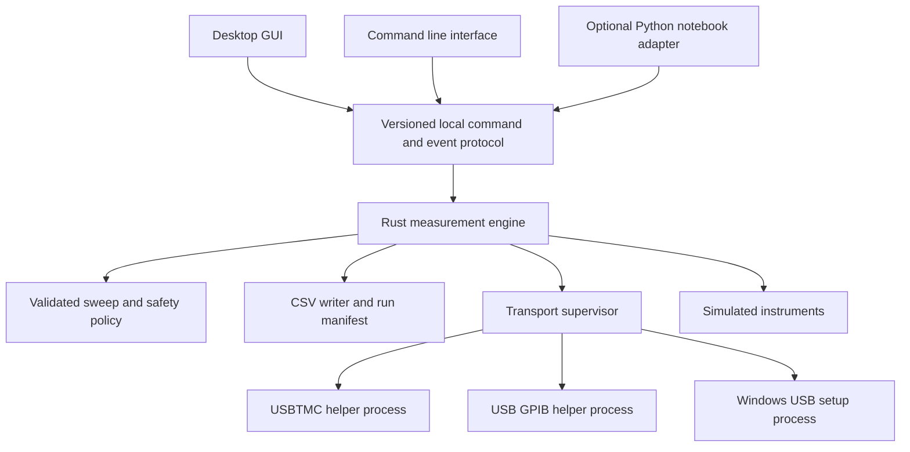

# KohdaLab IV Next Version Implementation Plan / KohdaLab IV 次期バージョン実装計画

> **日本語の案内:** これは作成時点の設計・移行計画を保存した開発記録です。測定値、
> ファイル名、実装上の契約は原文のまま参照してください。

Historical migration plan. Current source and commands are described in [repository layout](repository-layout.md). Retired Python links below are pinned to their historical source.

Date: 2026-10-13. Baseline: the working v0.2.3 portable application, including
the Windows driver recovery update published on 2026-10-07.

Build a new desktop version around a Rust measurement engine and a Rust GUI.
Use egui, eframe, and egui_plot for the first prototype. Keep the tested native
USB and GPIB helpers in separate processes while transferring measurement
logic to Rust. Release the successor when measurement compatibility, recovery,
performance, and portable packaging pass their acceptance checks.

This is an implementation plan. Numeric performance targets below are proposed
acceptance targets, not measured results. The existing Python release remains
available throughout development. The new release number will be coordinated
with the repository roadmap before packaging; this plan does not change 0.2.3.

## Product requirements

The desktop application should open promptly, explain connection activity,
remain responsive during scans and measurements, and use bounded memory during
long runs. Instrument identity, source limits, measurement provenance, and
cleanup behavior must remain explicit and testable.

The native Rust edition of KohdaLab Camera is the user's reference for the
desired responsiveness. Match its immediate control feedback, stable layout,
and smooth interaction during background work. Compare the IV prototype and
the camera application on the same desktop for resizing, opening selectors,
editing settings, and operating the main view. Record input to visible update
latency and frame time spikes. Camera throughput is not an IV measurement
speed target, and its resource figures are not substitutes for IV benchmarks.

The first hardware milestone covers the configurations already used in this
project: GS210 and Agilent or Keysight 34411A, connected by direct USB, NI
GPIB-USB-HS+, or Agilent 82357B. Mixed direct USB and GPIB connections are part
of the test matrix. One GPIB adapter at a time is the initial supported setup.

The first desktop replacement must also account for the current portable
instrument models and modes. Any model without completed parity remains
clearly marked unavailable in the preview. The Python toolkit continues to
provide its existing VISA and notebook workflows. General USB instrument
support, multiple simultaneous GPIB adapters, and new instrument models require
their own capability and hardware validation.

Initial platform targets match the portable release: Apple Silicon with macOS
13 or later, and Windows 10 or 11 x64. Confirm the chosen graphics backend and
the actual supported OS versions during the prototype and packaging phases.

## Technology selection

| Component | Proposed implementation | Reason |
| --- | --- | --- |
| Measurement planning and execution | Rust | Typed state, ownership, explicit errors, and a shared engine for all entry points |
| Desktop GUI | egui and eframe | Rust development and cross platform desktop integration |
| Live graphs | egui_plot | Existing Rust plotting components with custom axes, curves, and interactions |
| Instrument communication | Existing C and C++ helper processes initially | Preserve the successful USB, NI, and 82357B work |
| Windows USB setup | Existing USB setup and libwdi process | Preserve driver assignment, recovery, and the log sharing fix |
| Configuration and capability data | JSON and TOML | Import existing profiles and reuse reviewed instrument specifications |
| Results | Compatible CSV plus a versioned JSON run manifest | Preserve analysis workflows and record run outcomes |
| Development environment | rustup, Cargo, and a pinned toolchain | Repeatable builds, dependencies, tests, formatting, and linting |

The [egui project](https://github.com/emilk/egui) supports Mac and Windows
through eframe, configurable styling, and accessibility integration. It also
documents evolving APIs. Pin dependency versions and isolate GUI code from the
engine so upgrades stay local. Use [egui_plot](https://github.com/emilk/egui_plot)
for the graph prototype, with application controlled data preparation.

The camera implementation already uses egui and eframe with the glow renderer
and selected features. Use this working stack as the first IV renderer candidate,
then verify supported OSes, latency, CPU, and memory. Evaluate synchronization
and repaint settings for IV rather than copying camera frame timing blindly.
Its separate acquisition and rendering workers, immutable snapshots, and
bounded handover provide concrete patterns for the IV prototype.

[Slint](https://slint.dev/faqs) is the alternative if the prototype cannot meet
the required layout, accessibility, or interaction quality. Evaluate its
license and plotting integration before adoption. [Tauri](https://tauri.app/concept/process-model/)
uses OS webviews, including WebView2 on Windows; a web interface remains an
option for later remote workflows. The initial desktop direction favors Rust
for both UI and engine. Rewriting the whole application in C++ would leave more
memory correctness dependent on manual review and tooling.

Rust improves memory safety within safe Rust. C and C++ helpers, OS drivers,
graphics libraries, and any future foreign function interface retain their
own risks. Process isolation limits corruption crossing into the engine;
it does not guarantee that an instrument output is disabled after a crash.
The [Rust FFI guidance](https://doc.rust-lang.org/nomicon/ffi.html) describes
the obligations at native code boundaries.

## Application architecture

The engine is a supervised local process. It owns the measurement session and
instrument handles. The GUI sends typed requests and renders bounded snapshots
and events; it does not perform instrument I/O on its UI thread. The CLI and
optional Python adapter use the same validation and execution paths.

Each frontend initially launches and owns its own engine through pipes.
Simultaneous clients of one engine are a later extension. Acquire OS enforced
exclusive leases for the physical devices and GPIB adapter, in a stable order,
before opening a session. A second GUI, CLI, or notebook process must receive
a DeviceBusy result instead of competing for the same hardware. Cross process
ownership is required in addition to serializing operations inside an engine.

A single transport worker serializes operations on a shared GPIB adapter.
Source and meter connections share that worker. Discovery, driver setup, and
bus reset cannot compete with an active run. Direct USB uses one owner per
physical device. Persistent helpers avoid launching a process for every point.

Initially, the Rust transport adapter speaks the existing helper protocol.
Requests are ASCII lines in `operation address timeout_ms hex_payload\n` form.
Payload bytes are encoded as hexadecimal; a single `-` means an empty request
payload. GPIB addresses are 1 through 30; USB helper requests use address 0.
Preserve command terminators inside the encoded payload. Responses are
`KIV<TAB>OK|ERR<TAB>hex_payload\n`, with an empty hexadecimal field for an empty
response. Decode error payloads without treating them as instrument data.

The persistent helper emits a framed startup response before requests. USB
`--list` emits one response and exits; GPIB `--available` emits a presence flag,
which does not prove the bus is usable. Match these launch modes separately.
GPIB operations include LIST, WRITE, READ, QUERY, CLEAR, LOCAL, REN, and EXIT.
USB supports WRITE, READ, QUERY, LOCAL, REN, and EXIT; its present helper has
no CLEAR operation. REN payload `0` releases remote enable. Retain cleanup
behavior after poisoned transfers without reusing stale data.

Initially identify the legacy protocol through the packaged helper checksum
and manifest. Consume its existing startup response instead of sending an
unsupported version query. A future version flag or handshake must explicitly
preserve that fallback. Bound each protocol line to 64 KiB, decoded payloads
to 16 KiB, and startup preamble accumulation to 64 KiB in the Rust adapter;
respect stricter backend limits such as the 82357B 4096 byte read limit.
Keep new helper diagnostics on stderr, while tolerating bounded legacy startup
messages before the first KIV frame. Test split frames, empty payloads, invalid
hex, EOF, startup errors, and all operations against compatibility fixtures
before integrating the Rust transport adapter.

The GUI to engine protocol uses bounded, versioned JSON messages with request
IDs, deadlines, structured errors, and events. Use owned stdin and stdout
pipes, with no network listener in the first release. Reject oversized or
malformed messages and stale events. Cancellation and output control use a
priority control path rather than waiting behind graph or log updates.

Keep the core free of unsafe application code. If direct native bindings are
introduced later, put them in a small audited adapter with documented ownership,
lifetimes, and thread requirements. Do not add Tokio, a web runtime, a plugin
system, or a service framework until a concrete requirement justifies it.

## Measurement state and output handling

Represent run state explicitly: Idle, Validating, Preparing, Running,
Stopping, CleaningUp, Completed, Stopped, and Failed. Track discovery and
driver setup separately. Track source output independently as Unknown, Off,
or On; connection and cleanup errors must not imply Off.

1. Validate the complete plan, source capabilities, limits, selected identities,
   and output path before enabling output.
2. Establish instrument hardware compliance before the sweep. Software limits
   complement the hardware settings and retain existing semantics.
3. Freeze the active plan during execution. GUI edits belong to the next run.
4. Check cancellation before starting each new operation and during waits.
   Give every I/O operation an explicit deadline.
5. On completion, stop, or error, follow the configured zero ramp and output
   cleanup policy, preserve completed rows, and report cleanup success or failure.
6. Start a new run only through a new explicit Start command. Reconnection
   cannot resume output or replay an interrupted setpoint automatically.

Preparing must create the actual destination file with collision protection,
write the CSV header, and flush successfully before any output enable command.
Checking a path or its parent permissions alone is insufficient. A read only
destination or full disk at startup must fail with no source output enable
command sent. Mid run writer errors take the documented cleanup path.

Check point counts and integer arithmetic before allocation. Use a bounded
plan size or lazy sweep iteration for large runs. Reject nonfinite values,
invalid units, and excessive configuration or protocol input before opening
hardware. Allocation failure must not be a normal way to enforce these limits.

Stop acknowledgement should be immediate in the UI. A blocking native operation
can still take until its I/O deadline to return; priority control does not make
an existing libusb call instantly cancellable. Specify and test the worst case
stop latency for each backend, including the cleanup operations and ramp time.

The frontend sends a session heartbeat every 500 ms. A control thread inside
the engine checks a monotonic lease deadline at least every 100 ms, independently
of instrument I/O and the GUI event stream. Pipe EOF cancels immediately;
2 seconds without a heartbeat transitions an active run to Stopping and sets
its cancellation token. Begin cleanup at the next safe operation boundary or
I/O deadline. Test killing each frontend while output is on, stalled IPC, and
lost heartbeats, and measure the resulting cleanup latency. Lease expiry is
a stop request, not evidence of physical output off.

An orderly application exit waits for cleanup. Helper failure, engine
crash, cable removal, or loss of power can make output state unverifiable.
Show that state explicitly with a manual instrument output off instruction.
Keep hardware compliance and the instrument's physical controls as independent
protection. Killing a helper is a last recovery step after deadlines and
cleanup attempts; it is not a successful output off operation.

## Compatibility requirements

| Area | Contract to preserve |
| --- | --- |
| Measurement modes | dc_iv and dc_vi, source and meter roles, and existing V and A provenance |
| Sweep patterns | linear, round_trip, zero_centered, custom_list, repetitions, point order, join handling, and direction labels |
| Numeric planning | Engineering units, decimal endpoint behavior, source resolution, range selection, and invalid input rejection |
| Timing and readings | Start settling, per point settling, NPLC, averaging, readback, and configured timeouts |
| Safety | Hardware and software compliance, source limits, and finish, stop, and error cleanup policies |
| Profiles | Read config_version 1, including normalized legacy files; reject unsupported versions before hardware access |
| CSV | Preserve IV_FIELDS order, units, origins, missing value behavior, and compatible numeric formatting |
| Device identity | Verify actual manufacturer and model before model specific commands; preserve Agilent and Keysight 34411A equivalence |
| Resource selection | Preserve resource strings, distinguish serials and bus addresses, and reject stale or mismatched selections |
| User data | Preserve existing profiles and results; use a separate next version state file to prevent incompatible UI state writes |

Use the existing JSON schema and TOML capability files as shared inputs during
transition. Do not maintain two hand edited copies of instrument hard limits.
Store migrated settings in a new file with a schema version; retain the original.
Read configs with explicit paths and resolve relative output paths consistently.

The Python API remains available in the existing package. A future small Python
adapter can invoke the Rust engine for notebook automation without bundling
Python into the desktop. It must document which public calls it preserves.

Other models currently represented in the toolkit include Yokogawa 7651,
Agilent 34401A, Keysight 34465A, and ADCMT 7461A. Transfer command behavior and
capability checks through fixtures, then validate the available physical
models. The same VID and PID do not alone establish support for every GS200
family model or a different firmware variant.

## Device discovery and recovery

Display physically discovered resources independently of configured addresses.
Show recognized devices, unidentified GPIB listeners, and connected adapters
that need setup. A saved profile is a remembered selection, not evidence that
its instrument is present.

Direct USB discovery first reads descriptors. GPIB discovery uses the existing
listener detection on addresses 1 through 30, with the controller address
excluded. Identity queries happen through a model appropriate connection path.
Unknown devices remain visible with their resource and support status.
USBTMC mode is required for GS210 direct USB; storage mode is a separate device
function and must have a useful explanation.

Refresh has phases, elapsed time, partial results, and an overall deadline.
Repeated clicks coalesce into one scan. Cancellation invalidates late results.
A failed USB branch must not erase successful GPIB discovery, or vice versa.
Cached entries are labeled last seen and revalidated on Connect. If multiple
supported GPIB adapters are attached, show that this setup is unsupported and
request disconnecting the extras. Do not offer a selector that the retained
helper cannot honor. Future adapter selection requires stable physical adapter
IDs, an explicit helper selection argument, resource mapping, and compatibility
tests before enabling the UI.

Preserve Windows support for missing driver assignments and reinstall recovery.
Run setup after the first window is visible, only for supported interfaces that
need it. Display administrator approval, install, enumeration, ready, cancelled,
and failed states. Skip installation when the device is already ready. Retain
the tested libwdi log sharing fix and verify the active WinUSB interface after
setup. Normal startup and Refresh must not repeatedly reinstall drivers.

An interrupted or stalled USB transaction poisons the connection so stale
responses cannot enter a later query. Close and revalidate before recovery.
Use documented backend clear or reset operations where implemented; show a
replug instruction if recovery fails. Do not blindly retry a source write after
an ambiguous failure. Validate both NI and 82357B on both release platforms.

## UI and UX

Keep a familiar arrangement: a compact settings panel on the left and a large
graph in the main area. Replace permanent log space and thick panel controls
with a collapsible details area. Keep advanced settings reachable without
crowding the normal measurement workflow.

| Region | Content and interaction |
| --- | --- |
| Header | Profile name, overall readiness, and connection activity |
| Left panel | Source and meter cards, matching identities, transport, sweep parameters, output destination, and advanced settings |
| Main panel | Live IV or VI plot, axis units, sweep direction, zoom, cursor readout, and an Auto scale toggle |
| Run bar | Start, Stop, Output Off, current phase, point count, and elapsed time; always visible |
| Details drawer | Searchable logs, latest values, errors, driver status, and copyable diagnostics |
| Result summary | Completed or partial outcome, cleanup status, CSV path, and an Open folder action |

Device selectors show friendly model, serial number, and USB or GPIB address.
The complete resource is copyable in details. Opening any selector expands its
popup to fit the content, constrained to the screen. The closed control and
panel widths remain stable. Keyboard selection and focus order are explicit.

Use a consistent spacing scale, readable typography, a restrained accent color,
and distinct hover, focus, disabled, warning, and error states. Support system,
light, and dark themes. State must be readable through text and icons as well
as color. Avoid decorative animation during measurement.

Start stays disabled with an explanation until devices and settings are valid.
Show point count, range, source limit, and output path before Start. Stop and
Output Off remain available during execution, with Stopping displayed while
hardware cleanup proceeds. Validation errors appear beside the relevant field.
Recovery actions include Retry, Reconnect, Check driver, and Copy diagnostics.

Preserve the user's zoom during live acquisition. Update Auto scale only when
enabled. Clearly separate sweep directions and show engineering prefixes
without changing stored SI values. Resize or collapse the settings panel for
small screens. Test at 1280 by 800 and common high DPI settings on both OSes.
Include fonts with suitable licenses for scientific symbols, Greek letters,
and Japanese paths; verify text input and accessibility on actual desktop builds.

Use the camera application's restrained controls and stable main view as the
interaction reference. Opening a selector, switching settings, or expanding
diagnostics must not unexpectedly move the plot or grow the settings panel.
Cache expensive plot preparation outside the UI pass and wake the GUI on
state changes, new display snapshots, or user input. A low frequency watchdog
can expose stalled work without a continuous stale data repaint loop.

## Performance and data handling

The current GUI rebuilds plot data from all collected rows on every point in
`handle_point` and `_update_plot`. The successor should append compact numeric
records incrementally, update resistance statistics incrementally with the
same calculation semantics, and prepare only the visible graph data.

Persist every acquired point. Keep CSV flushing behavior equivalent during the
first port. A later buffering change must declare its possible data loss window
and pass a separate durability test. Flushing userspace buffers does not by
itself guarantee survival of a power failure. Treat disk full and writer errors
as run failures that trigger cleanup; do not continue silently without results.

Bound event queues, logs, and graph caches. Give acquired records a lossless
path to the writer with controlled backpressure. Coalesce display snapshots
when the GUI is behind. Use display decimation that preserves extrema,
direction changes, and discontinuities; CSV retains the complete data. Page
large result tables from disk rather than retaining dictionaries for all rows.
Throttle graph refresh to 10 to 20 Hz during acquisition and repaint on demand
while idle. Measurement execution must not wait for graph rendering.

Adapt the camera's latest snapshot handover only to display updates. Every
acquired IV point must still reach the CSV writer in order. The GUI may skip
intermediate snapshots while showing the newest status and accumulated curve;
the measurement records, compliance checks, and cleanup events remain lossless.

### Proposed acceptance targets

Measure the final packaged application on the same Mac and Windows PCs as
v0.2.3, using identical instruments, profiles, and timing. Include the engine
and all child processes in resource measurements. Record OS, hardware,
graphics backend, driver state, build revision, and artifact checksum.

| Metric | Initial target | Measurement conditions |
| --- | --- | --- |
| First interactive window | Cold start at most 2 seconds; warm start at most 1 second | Local extracted portable; driver setup and OS security approval timed separately; 10 launches for each case |
| Idle memory | Total resident or working set at most 100 MiB, and lower than the baseline | GUI, engine, and helpers summed after 60 seconds; report each OS metric separately |
| Idle CPU | At most 1 percent of one logical core averaged over 60 seconds | No scan, measurement, or animation |
| Stop feedback | Visible acknowledgement within 100 ms | Also report actual hardware cleanup latency under normal and timeout conditions |
| Repeated discovery | No hang or handle accumulation over 50 sequential Refresh operations | Both direct USB instruments, each GPIB adapter, mixed transports, and injected faults |
| Discovery deadline | Return completed or explicitly partial results within 30 seconds | Supported interfaces and normal scan; administrator approval and setup shown separately |
| Large graph | At least 30 frames per second during pan and zoom with 100000 saved points | Decimated display; complete CSV; report frame time percentiles and spikes |
| Long run memory | Display memory plateaus during a simulated 1000000 point run | Bounded caches and queues; no dropped writer records |
| Measurement regression | Same planned targets and row semantics; no added software delay beyond measured repeatability | Same NPLC, averaging, settling, source limits, and transport; simulator and real hardware |
| Download size | Portable ZIP at most 40 MiB per platform as a stretch target | Include required helpers, licenses, and corresponding native source; report extracted size too |

These targets are engineering decisions for the prototype gate. If one cannot
be met, report the cause and tradeoff before changing it. Do not reduce settling,
NPLC, numerical checks, or scientific acceptance criteria to improve a benchmark.
Do not count omitted source or licensing material as a size improvement.

## Automation and AI integration

Define explicit commands such as ListDevices, Connect, ValidatePlan, StartRun,
StopRun, GetStatus, and GetResult. Commands return structured errors and events
with run IDs and schema versions. The engine enforces limits regardless of
whether the caller is the GUI, a notebook, or a later AI adapter.

A future AI interface can propose settings, inspect diagnostics, or summarize
results. It must use the same validated plan and explicit Start operation.
The normal application works offline and does not require a model, account,
network request, or background AI service. Avoid unrestricted SCPI or shell
execution in the normal automation API. Any remote API requires a separate
authentication and deployment design.

## Development and distribution

Place the initial Cargo workspace under `next/` so Python packaging and the
existing release scripts keep their current scope. Suggested crates are
`iv-core`, `iv-instruments`, `iv-transport`, `iv-engine`, `iv-desktop`, and
`iv-cli`. Keep protocol types independent of the GUI. Add adapters only when
their consumers are implemented.

Commit Cargo.lock for application dependencies and pin an exact supported Rust
release in rust-toolchain.toml. Use stable Rust, rustfmt, Clippy, unit and
integration tests, dependency audits, and a documented minimum toolchain.
Build release artifacts on macOS arm64 and Windows x64 runners; compilation
alone is not a Windows driver or hardware test.

The portable entry point remains KohdaLab IV.app on Mac and KohdaLab IV.exe on
Windows, with a compact support directory for helpers, setup, licenses, and
source. Users do not need Rust, Cargo, Python, or vendor VISA for the validated
native connections. Windows driver assignment can still require administrator
approval. Preserve checksum verified 82357B firmware acquisition without
redistributing restricted firmware.

The first 82357B setup requires network access to obtain its firmware; normal
use can be offline once the verified firmware is cached. Show the download
prerequisite before setup and report offline, cancelled, failed download, and
checksum mismatch outcomes with retry instructions. Test first setup online,
first setup offline, cancellation, a bad checksum, and later offline startup
on both platforms. A missing or unverified firmware file must not be executed
or presented as a ready adapter.

Include an English README, hardware and connection matrix, checksums, release
notes, corresponding native source, modifications, and rebuild instructions.
Retain GPL and LGPL notices and obligations across the new distribution.
Generate build kits from the same revision as the portable and validate them
in a clean build environment. Publish matching assets to the Kohdalab and
personal repositories after release verification.

Mac signing and notarization and Windows signing are separate release work.
A Rust rewrite does not remove OS download warnings. Record signing status
clearly and retain the standard OS approval path when certificates are absent.

## Implementation sequence

| Phase | Work | Exit condition |
| --- | --- | --- |
| 1 Baseline and GUI prototype | Measure current portable; create the Cargo workspace, simulator, themed layout, selectors, and large graph prototype using the camera Rust UI as the experience reference | Mac and Windows prototype compared against startup, memory, graph, layout, and input targets, plus the camera interaction reference; confirm GUI choice |
| 2 Measurement core | Port unit parsing, capability checks, decimal sweep planning, state, cleanup, CSV, and simulated execution | Existing scientific fixtures agree; finish, stop, compliance, and errors preserve outcomes and rows |
| 3 Native integration | Adapt helper protocol, session ownership, discovery, identity checks, Windows setup, and connection recovery | Direct USB, NI, and 82357B pass repeated connection tests and fault injection |
| 4 Full workflow | Connect the GUI and CLI to the engine; complete preview, progress, diagnostics, result summary, and legacy profile import | Same validated plan across entry points; no blocking I/O in GUI; data preserved after controlled failures |
| 5 Portable release | Build clean packages and kits; perform hardware runs, soak tests, and performance comparisons | Acceptance report, licenses, source, checksums, English docs, and release assets agree |

Begin with phase 1 and a simulator; review the rendered screens and measured
tradeoffs before transferring hardware control. Keep each migration step
reviewable and tested against v0.2.3 rather than rewriting every layer at once.

## Verification matrix

Use existing Python tests as executable behavior references and export fixtures
for point order, units, limits, CSV values, and command sequences. Port those
contracts to Rust tests. Add property tests for sweep endpoints and resolutions,
and fault tests for malformed protocol data, stale replies, helper exit, I/O
timeouts, disk full, identity mismatch, and cancellation at every run phase.
Include full disk or denied file creation before output enable, and frontend
termination or heartbeat expiry during an active run.

Verify direct USB GS210 and 34411A, NI GPIB, 82357B GPIB, and mixed transports
on Mac arm64 and Windows x64. Include driver removal and reassignment, restart,
USB reconnect, wrong resource selection, repeated Refresh, and output cleanup.
Record models, serials, firmware, addresses, commands, durations, and results
in local test evidence; do not publish personal machine details unnecessarily.

Start physical tests with identification and output off checks. Electrical
tests require the current load, wiring, voltage range, and current limits to be
confirmed for that session. An open output verifies communication and state
handling; a known load and suitable references are needed to assess IV accuracy
and compliance behavior. Historical permission for an open output does not
describe a later wiring setup.

Exercise normal completion, user stop, compliance stop, timeout, unplug, helper
failure, GUI exit, engine failure, and writer failure. Report measured cleanup
latency and cases where hardware output could not be verified. Perform a
minimum 60 minute run on each primary hardware route and a longer simulated
run to inspect memory and resource growth.

The successor is ready for general distribution when its declared feature
matrix is complete, compatibility checks pass, hardware and recovery evidence
is recorded, performance is compared on matching machines, and the final
portable runs on clean PCs after its supported driver setup and documented
initial firmware download. The existing release remains downloadable for
workflows outside the successor's validated support matrix.

## Existing implementation references

- [Measurement specification](../reference/measurement-spec.md)
- [Usage and configuration](https://github.com/woolen-yarn/kohdalab-iv/blob/5f35cbaf88175bc9f5068a51bac639b1bdb0943d/docs/usage.md)
- [Portable release guide](https://github.com/woolen-yarn/kohdalab-iv/blob/5f35cbaf88175bc9f5068a51bac639b1bdb0943d/docs/portable_release.md)
- [Hardware smoke test](../guides/hardware-validation.md)
- [Safety notes](../../SAFETY.md)
- [Sweep planning](https://github.com/woolen-yarn/kohdalab-iv/blob/5f35cbaf88175bc9f5068a51bac639b1bdb0943d/src/kohdalab_iv/api/scan_plan.py)
- [Measurement execution](https://github.com/woolen-yarn/kohdalab-iv/blob/5f35cbaf88175bc9f5068a51bac639b1bdb0943d/src/kohdalab_iv/api/measurements.py)
- [CSV field contract](https://github.com/woolen-yarn/kohdalab-iv/blob/5f35cbaf88175bc9f5068a51bac639b1bdb0943d/src/kohdalab_iv/api/measurement_rows.py)
- [Session identity and ownership](https://github.com/woolen-yarn/kohdalab-iv/blob/5f35cbaf88175bc9f5068a51bac639b1bdb0943d/src/kohdalab_iv/api/session.py)
- [Current GUI and plotting](https://github.com/woolen-yarn/kohdalab-iv/blob/5f35cbaf88175bc9f5068a51bac639b1bdb0943d/src/kohdalab_iv/apps/iv_gui.py)
- [Native helper build and licensing](../../native/README.md)

---

# KohdaLab IV 次期バージョン実装計画

これは履歴上の移行計画です。現在の source と commands は[リポジトリ構成](repository-layout.md)にあります。
下記の retired Python links は履歴 source に固定しています。日付は 2026-10-13、baseline は 2026-10-07 の
Windows driver recovery update を含む動作中 v0.2.3 portable application です。

Rust measurement engine と Rust GUI を中心に新 desktop version を構築します。first prototype は egui、eframe、
egui_plot を用います。measurement logic を Rust へ移しつつ、検証済み native USB/GPIB helpers は separate processes に
残します。measurement compatibility、recovery、performance、portable packaging が acceptance checks を通過した時に
successor を release します。以下の numeric performance targets は提案 acceptance targets で、measured results では
ありません。既存 Python release は開発中も利用可能です。新 release number は packaging 前に repository roadmap と
調整し、この plan は 0.2.3 を変更しません。

## 製品要件

desktop application は速やかに開き、connection activity を説明し、scan/measurement 中も responsive で、long runs で
bounded memory を使うべきです。instrument identity、source limits、measurement provenance、cleanup behavior は明示的かつ
testable に保ちます。KohdaLab Camera の native Rust edition を desired responsiveness の reference とします。同じ
desktop で IV prototype と camera application の resize、selector 開始、settings 編集、main view 操作を比較し、
input-to-visible-update latency と frame-time spikes を記録します。Camera throughput は IV measurement speed target ではなく、
resource figures は IV benchmarks の代替ではありません。

first hardware milestone は、direct USB、NI GPIB-USB-HS+、Agilent 82357B で接続する GS210 と Agilent/Keysight 34411A を
扱います。mixed direct USB/GPIB も test matrix に含め、initial setup では一度に一個の GPIB adapter を support します。
first desktop replacement は current portable の instrument models/modes も考慮し、parity 未完の model は preview で
unavailable と明記します。Python toolkit は既存 VISA/notebook workflows を提供し続けます。general USB support、
multiple simultaneous GPIB adapters、新 instrument models は個別 capability/hardware validation を必要とします。
initial platform targets は macOS 13 以降 Apple Silicon、Windows 10/11 x64 で、graphics backend と実際の supported OS
versions は prototype/packaging phases で確認します。

## 技術選定

| コンポーネント | 提案実装 | 理由 |
| --- | --- | --- |
| Measurement planning/execution | Rust | typed state、ownership、explicit errors、全 entry points の shared engine |
| Desktop GUI | egui と eframe | Rust 開発と cross-platform desktop integration |
| Live graphs | egui_plot | custom axes/curves/interactions を持つ既存 Rust plotting components |
| Instrument communication | 最初は既存 C/C++ helper processes | 成功済み USB、NI、82357B 作業を保持 |
| Windows USB setup | existing USB setup/libwdi process | driver assignment、recovery、log sharing fix を保持 |
| Configuration/capability data | JSON と TOML | existing profiles の import と review 済み instrument specifications の再利用 |
| Results | compatible CSV と versioned JSON run manifest | analysis workflows を保持し run outcomes を記録 |
| Development environment | rustup、Cargo、pinned toolchain | repeatable builds、dependencies、tests、formatting、linting |

[egui project](https://github.com/emilk/egui) は eframe による Mac/Windows、configurable styling、accessibility integration を
support し、evolving APIs も文書化します。dependency versions を pin し GUI code を engine から隔離します。
[egui_plot](https://github.com/emilk/egui_plot) を application-controlled data preparation の graph prototype に使います。
camera implementation は既に glow renderer/selected features 付き egui/eframe を使うため first IV renderer candidate とし、
supported OSes、latency、CPU、memory を検証します。camera frame timing を盲目的にコピーせず IV の synchronization/repaint
settings を評価します。separate acquisition/rendering workers、immutable snapshots、bounded handover は IV prototype の具体例です。
[Slint](https://slint.dev/faqs) は layout/accessibility/interaction quality が満たせない場合の alternative で、adoption 前に
license/plotting integration を評価します。[Tauri](https://tauri.app/concept/process-model/) は Windows WebView2 を含む OS webviews
を使い、web interface は将来 remote workflows の option です。initial direction は UI/engine とも Rust を選びます。全 C++
書換えは memory correctness を manual review/tooling へより依存させます。safe Rust は Rust 内の memory safety を改善しますが、
C/C++ helpers、OS drivers、graphics libraries、future FFI には別の risks が残ります。process isolation は engine への
corruption crossing を制限しますが、crash 後の instrument output off を保証しません。

## アプリケーションアーキテクチャ

上の Mermaid 図は、Desktop GUI、CLI、optional Python notebook adapter が versioned local command/event protocol を通じて
Rust measurement engine へ接続し、engine が validated sweep/safety policy、CSV writer/run manifest、transport supervisor、
USBTMC/GPIB helpers、simulated instruments、Windows USB setup process を所有することを示します。engine は supervised local
process で measurement session/instrument handles を所有します。GUI は typed requests を送り bounded snapshots/events を描画し、
UI thread で instrument I/O を行いません。CLI/Python adapter も同じ validation/execution paths を使います。

各 frontend は最初は pipes で自身の engine を起動・所有します。一 engine の simultaneous clients は後の extension です。
physical devices/GPIB adapter に OS-enforced exclusive leases を stable order で取得してから session を開きます。second GUI/CLI/notebook
は同 hardware に競合せず DeviceBusy を受けます。cross-process ownership は engine 内 operation serialization に加えて必要です。
single transport worker が shared GPIB adapter operations を直列化し、source/meter connections はこれを共有します。discovery、driver
setup、bus reset は active run と競合できません。direct USB は physical device ごとに一 owner を使い、persistent helpers により point ごとの
process launch を避けます。

Rust transport adapter は初期には existing helper protocol を話します。request は `operation address timeout_ms hex_payload\n` の
ASCII lines、payload bytes は hexadecimal、empty request payload は一個の `-`、GPIB addresses は 1–30、USB helper requests は address 0、
command terminators は encoded payload 内に保存します。response は `KIV<TAB>OK|ERR<TAB>hex_payload\n`、empty response は empty hexadecimal
field です。error payload を instrument data と扱わず decode します。persistent helper は requests 前に framed startup response を出し、USB
`--list` は一 response 後 exit、GPIB `--available` は bus usable を証明しない presence flag を出すため launch modes を分離して扱います。
GPIB operations は LIST/WRITE/READ/QUERY/CLEAR/LOCAL/REN/EXIT、USB は WRITE/READ/QUERY/LOCAL/REN/EXIT（現 helper は CLEAR なし）で、
REN payload `0` は remote enable を release します。poisoned transfers 後も stale data を再利用せず cleanup を保持します。

legacy protocol は packaged helper checksum/manifest と existing startup response で identify し、unsupported version query を送りません。
future version flag/handshake は fallback を明示的に保持します。Rust adapter は protocol line 64 KiB、decoded payload 16 KiB、startup
preamble accumulation 64 KiB に bound し、82357B 4096 byte read limit 等の stricter backend limits を尊重します。new helper diagnostics は stderr、
first KIV frame 前の bounded legacy startup messages は許容します。transport integration 前に split frames、empty payloads、invalid hex、EOF、
startup errors、全 operations を compatibility fixtures で試験します。GUI-engine protocol は bounded/versioned JSON、request IDs、deadlines、
structured errors/events を使い、first release に network listener はありません。oversized/malformed messages/stale events を拒否し、cancellation/output
control は graph/log updates の後ろで待たない priority control path を使います。core は unsafe application code なしにし、direct native bindings を
後で導入する場合は ownership/lifetimes/thread requirements を文書化した小さな audited adapter に置きます。concrete requirement なしに Tokio、web runtime、plugin system、service framework を追加しません。

## Measurement state と output handling

run state は Idle、Validating、Preparing、Running、Stopping、CleaningUp、Completed、Stopped、Failed を明示し、discovery/driver setup は別追跡します。
source output は Unknown/Off/On を独立追跡し、connection/cleanup errors から Off を推論しません。output 有効化前に complete plan、source capabilities、limits、selected identities、output path を validate し、sweep 前に hardware compliance を確立して software limits を補完します。execution 中は active plan を freeze し GUI edits は次 run に属します。各 operation 前と waits 中に cancellation を確認し、全 I/O に deadline を与えます。completion/stop/error では configured zero ramp/output cleanup policy に従い、completed rows を保持して cleanup success/failure を報告します。new run は明示的 Start だけで開始し、reconnection は output resume/interrupted setpoint replay を自動で行いません。

Preparing は output enable command 前に collision protection 付き actual destination file 作成、CSV header 書込み、成功した flush を行う必要があります。path/parent permissions の確認だけでは不十分で、read-only destination/full disk は source output enable command なしに失敗します。mid-run writer errors は documented cleanup path へ進みます。allocation 前に point counts/integer arithmetic を確認し、large runs には bounded plan size/lazy sweep iteration を使います。hardware を開く前に nonfinite values、invalid units、excessive configuration/protocol input を拒否し、allocation failure を limit enforcement に使いません。

Stop acknowledgement は UI で immediate にしますが、blocking native operation は I/O deadline まで戻らないことがあり、priority control は既存 libusb call を即時 cancellable にしません。backend ごとに cleanup/ramp を含む worst-case stop latency を指定・試験します。frontend は 500 ms ごとに session heartbeat、engine control thread は instrument I/O/GUI event stream と独立して少なくとも 100 ms ごとに monotonic lease deadline を確認します。pipe EOF は即 cancel、2 seconds heartbeat なしは active run を Stopping にし cancellation token を set します。next safe operation boundary/I/O deadline で cleanup を開始し、output on 中の frontend kill、stalled IPC、lost heartbeats と cleanup latency を試験します。lease expiry は stop request であり physical output off の証拠ではありません。orderly exit は cleanup を待ち、helper failure/engine crash/cable removal/power loss は output state を unverifiable にするため manual instrument output off instruction と共に明示表示します。hardware compliance/physical controls は独立保護であり、helper kill は deadline/cleanup attempts 後の last recovery で successful output off ではありません。

## 互換性、発見、UI/UX、性能

以下を保存します: `dc_iv`/`dc_vi`、source/meter roles、V/A provenance、linear/round_trip/zero_centered/custom_list、repetitions、point order/join handling/direction labels、engineering units/decimal endpoints/source resolution/range selection/invalid input rejection、start/per-point settling/NPLC/averaging/readback/timeouts、hardware/software compliance/source limits/finish-stop-error cleanup、config_version 1 と normalized legacy files、IV_FIELDS order/units/origins/missing values/numeric formatting、actual manufacturer/model verification と Agilent/Keysight 34411A equivalence、resource strings/serials/bus addresses/stale selection rejection、既存 profiles/results と incompatible UI state write を避ける separate next-version state file。transition 中は existing JSON schema/TOML capability files を shared inputs とし、instrument hard limits の hand-edited copy を二つ作りません。migrated settings は schema version を持つ new file に保存して original を残し、explicit paths で configs を読み relative output paths を一貫して resolve します。Python API は existing package で利用可能とし、future small adapter は desktop に Python を bundle せず Rust engine を notebook automation 用に呼び、preserved public calls を文書化します。7651、34401A、34465A、7461A の command behavior/capability checks は fixtures で移し available physical models を検証します。同じ VID/PID は全 GS200 family/firmware variant support を単独で示しません。

physically discovered resources は configured addresses と独立表示し、recognized devices、unidentified GPIB listeners、setup が必要な adapters を示します。saved profile は remembered selection で presence の証拠ではありません。direct USB discovery は descriptors を先に読み、GPIB discovery は controller address を除く 1–30 listener detection を使い、identity queries は model-appropriate connection path を通します。unknown devices は resource/support status と共に残します。GS210 direct USB には USBTMC mode が必要で、storage mode は別 device function として説明します。Refresh は phases/elapsed time/partial results/overall deadline を持ち、repeated clicks は一 scan に coalesce、cancellation は late results を無効化します。一 USB branch failure が successful GPIB discovery を消すことはなく、その逆も同様です。cached entries は last seen として label し Connect 時に revalidate します。multiple supported GPIB adapters は unsupported と示し extras の disconnect を求め、retained helper が honor できない selector を提供しません。future adapter selection には stable physical adapter IDs、explicit helper selection argument、resource mapping、compatibility tests が必要です。

Windows では missing driver assignments/reinstall recovery を保持し、first window visible 後、必要な supported interfaces だけに setup を実行します。administrator approval/install/enumeration/ready/cancelled/failed を表示し ready device の installation は skip します。libwdi log sharing fix を保持して setup 後 active WinUSB interface を確認し、normal startup/Refresh が repeatedly drivers を reinstall しないようにします。interrupted/stalled USB transaction は stale responses が later query に入らないよう connection を poison し、recovery 前に close/revalidate します。implemented backend clear/reset を使い、失敗時は replug instruction を示し、ambiguous failure 後に source write を盲目的 retry しません。NI/82357B を両 release platforms で validate します。

UI は左の compact settings panel と main area の large graph を維持し、permanent log space/thick panel controls を collapsible details area へ置換します。advanced settings は normal workflow を混雑させず到達可能にします。Header は profile name/overall readiness/connection activity、Left panel は source/meter cards/matching identities/transport/sweep parameters/output destination/advanced settings、Main panel は live IV/VI plot/axis units/direction/zoom/cursor/Auto scale、Run bar は常時 visible の Start/Stop/Output Off/current phase/point count/elapsed time、Details drawer は searchable logs/latest values/errors/driver status/copyable diagnostics、Result summary は completed/partial outcome/cleanup status/CSV path/Open folder action を含みます。selectors は friendly model/serial/USB/GPIB address を示し complete resource は details で copyable、popup は screen 内で content に合わせ closed controls/panel widths は stable、keyboard selection/focus order は explicit です。spacing/typography/accent/hover/focus/disabled/warning/error states を一貫させ system/light/dark themes、text/icons/color による state readability、measurement 中の decorative animation 回避を行います。

Start は devices/settings valid まで explanation 付き disabled にし、Start 前に point count/range/source limit/output path を表示します。Stop/Output Off は execution 中も利用でき Stopping を cleanup 中に表示します。validation errors は relevant field のそばに出し、Retry/Reconnect/Check driver/Copy diagnostics を recovery actions とします。live acquisition 中も user zoom を保存し Auto scale は enabled 時だけ更新、directions を分け stored SI values を変えず engineering prefixes を示します。small screens は settings panel を resize/collapse し、両 OS の 1280 by 800/common high DPI で試験します。scientific symbols/Greek letters/Japanese paths 用の適切 license fonts を含め actual desktop builds で text input/accessibility を確認します。camera app の restrained controls/stable main view を reference にし selector/settings/diagnostics が plot を動かしたり settings panel を成長させたりしません。expensive plot preparation を UI pass 外に cache し、state change/new display snapshot/user input で GUI を wake、low-frequency watchdog は continuous stale-data repaint loop なしに stalled work を示します。

current GUI が `handle_point`/`_update_plot` 毎に全 collected rows から plot data を rebuild するため、successor は compact numeric records を incrementally append、同じ calculation semantics で resistance statistics を incrementally update、visible graph data のみを prepare します。acquired point はすべて persist し、first port では equivalent CSV flush を保ちます。later buffering change は data loss window を宣言して separate durability test を通り、userspace buffer flush は power failure 生存を保証しません。disk full/writer errors は cleanup を伴う run failure で、results なしに silently continue しません。event queues/logs/graph caches を bound し、acquired records は controlled backpressure で writer へ lossless path、GUI behind 時は display snapshots を coalesce します。display decimation は extrema/direction changes/discontinuities を保存し CSV は complete、large result tables は全 rows dictionaries 保持でなく disk から page、acquisition 中 graph refresh は 10–20 Hz、idle は on-demand repaint、measurement execution は graph rendering を待ちません。camera latest-snapshot handover は display updates だけに適用し、IV points は CSV writer に順序通り必ず到達、GUI は intermediate snapshots を skip して最新 status/curve を表示できますが measurement records/compliance/cleanup events は lossless です。

### 提案 acceptance targets

最終 packaged application は v0.2.3 と同じ Mac/Windows PCs、identical instruments/profiles/timing で測定し、engine と全 child processes を resource measurements に含めます。OS、hardware、graphics backend、driver state、build revision、artifact checksum を記録します。

| Metric | Initial target | Measurement conditions |
| --- | --- | --- |
| First interactive window | Cold start at most 2 seconds; warm start at most 1 second | local extracted portable、driver setup/OS security approval は別計測、各 10 launches |
| Idle memory | total resident/working set at most 100 MiB、baseline より低い | 60 seconds 後 GUI/engine/helpers 合計、OS metric を別報告 |
| Idle CPU | 60 seconds average で one logical core の at most 1 percent | scan/measurement/animation なし |
| Stop feedback | visible acknowledgement within 100 ms | normal/timeout の actual hardware cleanup latency も報告 |
| Repeated discovery | 50 sequential Refresh で hang/handle accumulation なし | direct USB、各 GPIB adapter、mixed transports、injected faults |
| Discovery deadline | 30 seconds 以内に completed/explicitly partial results | supported interfaces/normal scan、administrator approval/setup は別表示 |
| Large graph | 100000 saved points で pan/zoom at least 30 fps | decimated display、complete CSV、frame-time percentiles/spikes 報告 |
| Long run memory | simulated 1000000 point run で display memory plateaus | bounded caches/queues、writer records を drop しない |
| Measurement regression | same planned targets/row semantics、measured repeatability を超える software delay なし | same NPLC/averaging/settling/source limits/transport、simulator/real hardware |
| Download size | stretch target として platform ごと portable ZIP at most 40 MiB | required helpers/licenses/corresponding native source を含み extracted size も報告 |

これらは prototype gate の engineering decisions です。一つでも満たせない場合は変更前に cause/tradeoff を報告します。benchmark 改善のため settling、NPLC、numerical checks、scientific acceptance criteria を減らさず、source/licensing material の省略を size improvement と数えません。

## Automation、distribution、verification

ListDevices、Connect、ValidatePlan、StartRun、StopRun、GetStatus、GetResult の明示 commands を定義し、run IDs/schema versions 付き structured errors/events を返します。caller が GUI/notebook/later AI adapter のいずれでも engine が limits を強制します。future AI interface は settings proposal、diagnostics inspection、result summary をできても同じ validated plan/explicit Start を使います。normal app は offline で動作し model/account/network request/background AI service を必要とせず、normal automation API に unrestricted SCPI/shell execution を置きません。remote API は別 authentication/deployment design を必要とします。

initial Cargo workspace は Python packaging/existing release scripts の scope を保つため `next/` 下に置き、suggested crates は `iv-core`、`iv-instruments`、`iv-transport`、`iv-engine`、`iv-desktop`、`iv-cli` とします。protocol types は GUI から独立、adapters は consumer 実装時だけ追加します。application dependencies の Cargo.lock を commit、rust-toolchain.toml に exact supported Rust release を pin し stable Rust/rustfmt/Clippy/unit/integration tests/dependency audits/documented minimum toolchain を使います。macOS arm64/Windows x64 runners で release artifacts を build しますが、compilation alone は Windows driver/hardware test ではありません。

portable entry point は Mac の KohdaLab IV.app、Windows の KohdaLab IV.exe を維持し、helpers/setup/licenses/source 用 compact support directory を持ちます。validated native connections に users は Rust/Cargo/Python/vendor VISA を必要としませんが Windows driver assignment は administrator approval を要し得ます。restricted firmware を redistribute せず checksum-verified 82357B firmware acquisition を保存します。first 82357B setup は firmware 取得に network access を要し、verified firmware が cached されれば normal use は offline です。setup 前に download prerequisite を示し offline/cancelled/failed download/checksum mismatch と retry instructions を報告します。両 platforms で first setup online/offline、cancellation、bad checksum、later offline startup を試験し、missing/unverified firmware file を execute/ready adapter と表示しません。

English README、hardware/connection matrix、checksums、release notes、corresponding native source/modifications/rebuild instructions を含め、GPL/LGPL notices/obligations を new distribution でも保持します。portable と同 revision から build kits を生成し clean build environment で検証します。release verification 後 matching assets を Kohdalab/personal repositories へ publish します。Mac signing/notarization と Windows signing は別 release work で、Rust rewrite は OS download warnings を除去しません。signing status を明示し certificates 不在時は standard OS approval path を保ちます。

implementation sequence は、(1) baseline/GUI prototype: current portable を測定し Cargo workspace/simulator/themed layout/selectors/large graph prototype を camera Rust UI reference で作り、startup/memory/graph/layout/input targets と camera interaction reference に対する Mac/Windows comparison と GUI choice 確認で exit、(2) measurement core: unit parsing/capability checks/decimal sweep planning/state/cleanup/CSV/simulated execution を移し scientific fixtures と finish/stop/compliance/errors outcomes/rows を一致、(3) native integration: helper protocol/session ownership/discovery/identity checks/Windows setup/connection recovery を adapt し direct USB/NI/82357B の repeated connection/fault injection pass、(4) full workflow: GUI/CLI を engine に接続し preview/progress/diagnostics/result summary/legacy profile import を完了、entry points の同 plan、GUI blocking I/O なし、controlled failures 後 data preservation、(5) portable release: clean packages/kits/hardware runs/soak tests/performance comparisons を行い acceptance report/licenses/source/checksums/English docs/release assets の一致を exit とします。phase 1/simulator から始め rendered screens/measured tradeoffs を review してから hardware control を移し、各 migration step を v0.2.3 対比で reviewable/tested に保ち一度に全 layers を書換えません。

verification matrix は existing Python tests を point order/units/limits/CSV values/command sequences の executable behavior references として fixtures を export し Rust tests に移します。sweep endpoints/resolutions の property tests、malformed protocol data/stale replies/helper exit/I/O timeouts/disk full/identity mismatch/各 run phase cancellation の fault tests、output enable 前 full disk/denied file creation、active run 中 frontend termination/heartbeat expiry を追加します。Mac arm64/Windows x64 で direct USB GS210/34411A、NI GPIB、82357B GPIB、mixed transports を、driver removal/reassignment/restart/USB reconnect/wrong resource selection/repeated Refresh/output cleanup を含めて確認します。models/serials/firmware/addresses/commands/durations/results は local test evidence に記録し personal machine details を不要に公開しません。physical tests は identification/output-off checks から開始し、electrical tests ごとに current load/wiring/voltage range/current limits を確認します。open output は communication/state handling を検証しますが IV accuracy/compliance behavior には known load/suitable references が必要で、過去の open-output permission は後の wiring setup を記述しません。normal completion/user stop/compliance stop/timeout/unplug/helper failure/GUI exit/engine failure/writer failure を試し、measured cleanup latency と hardware output 未検証 cases を報告します。primary hardware route ごと minimum 60 minute run と memory/resource growth 用 longer simulated run を行います。successor は declared feature matrix 完了、compatibility checks pass、hardware/recovery evidence 記録、matching machines の performance comparison、supported driver setup/documented initial firmware download 後の clean PCs で final portable 実行時に general distribution の準備が整います。successor validated support matrix 外の workflows には existing release を引き続き download できます。

## 既存実装参照

- [Measurement specification](../reference/measurement-spec.md)
- [Usage and configuration](https://github.com/woolen-yarn/kohdalab-iv/blob/5f35cbaf88175bc9f5068a51bac639b1bdb0943d/docs/usage.md)
- [Portable release guide](https://github.com/woolen-yarn/kohdalab-iv/blob/5f35cbaf88175bc9f5068a51bac639b1bdb0943d/docs/portable_release.md)
- [Hardware smoke test](../guides/hardware-validation.md)
- [Safety notes](../../SAFETY.md)
- [Sweep planning](https://github.com/woolen-yarn/kohdalab-iv/blob/5f35cbaf88175bc9f5068a51bac639b1bdb0943d/src/kohdalab_iv/api/scan_plan.py)
- [Measurement execution](https://github.com/woolen-yarn/kohdalab-iv/blob/5f35cbaf88175bc9f5068a51bac639b1bdb0943d/src/kohdalab_iv/api/measurements.py)
- [CSV field contract](https://github.com/woolen-yarn/kohdalab-iv/blob/5f35cbaf88175bc9f5068a51bac639b1bdb0943d/src/kohdalab_iv/api/measurement_rows.py)
- [Session identity and ownership](https://github.com/woolen-yarn/kohdalab-iv/blob/5f35cbaf88175bc9f5068a51bac639b1bdb0943d/src/kohdalab_iv/api/session.py)
- [Current GUI and plotting](https://github.com/woolen-yarn/kohdalab-iv/blob/5f35cbaf88175bc9f5068a51bac639b1bdb0943d/src/kohdalab_iv/apps/iv_gui.py)
- [Native helper build and licensing](../../native/README.md)
