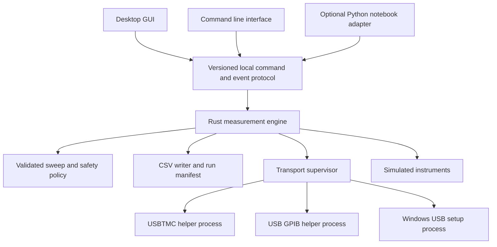

# KohdaLab IV Next Version Implementation Plan

Historical migration plan. Current source and commands are described in [repository layout](repository-layout.md). Retired Python links below are pinned to their historical source.

Date: 2026-10-13. Baseline: the working v0.2.3 portable application, including
the Windows driver recovery update published on 2026-10-07.

Build a new desktop version around a Rust measurement engine and a Rust GUI.
Use egui, eframe, and egui_plot for the first prototype. Keep the tested native
USB and GPIB helpers in separate processes while transferring measurement
logic to Rust. Release the successor when measurement compatibility, recovery,
performance, and portable packaging pass their acceptance checks.

This is an implementation plan. Numeric performance targets below are proposed
acceptance targets, not measured results. The existing Python release remains
available throughout development. The new release number will be coordinated
with the repository roadmap before packaging; this plan does not change 0.2.3.

## Product requirements

The desktop application should open promptly, explain connection activity,
remain responsive during scans and measurements, and use bounded memory during
long runs. Instrument identity, source limits, measurement provenance, and
cleanup behavior must remain explicit and testable.

The native Rust edition of KohdaLab Camera is the user's reference for the
desired responsiveness. Match its immediate control feedback, stable layout,
and smooth interaction during background work. Compare the IV prototype and
the camera application on the same desktop for resizing, opening selectors,
editing settings, and operating the main view. Record input to visible update
latency and frame time spikes. Camera throughput is not an IV measurement
speed target, and its resource figures are not substitutes for IV benchmarks.

The first hardware milestone covers the configurations already used in this
project: GS210 and Agilent or Keysight 34411A, connected by direct USB, NI
GPIB-USB-HS+, or Agilent 82357B. Mixed direct USB and GPIB connections are part
of the test matrix. One GPIB adapter at a time is the initial supported setup.

The first desktop replacement must also account for the current portable
instrument models and modes. Any model without completed parity remains
clearly marked unavailable in the preview. The Python toolkit continues to
provide its existing VISA and notebook workflows. General USB instrument
support, multiple simultaneous GPIB adapters, and new instrument models require
their own capability and hardware validation.

Initial platform targets match the portable release: Apple Silicon with macOS
13 or later, and Windows 10 or 11 x64. Confirm the chosen graphics backend and
the actual supported OS versions during the prototype and packaging phases.

## Technology selection

| Component | Proposed implementation | Reason |
| --- | --- | --- |
| Measurement planning and execution | Rust | Typed state, ownership, explicit errors, and a shared engine for all entry points |
| Desktop GUI | egui and eframe | Rust development and cross platform desktop integration |
| Live graphs | egui_plot | Existing Rust plotting components with custom axes, curves, and interactions |
| Instrument communication | Existing C and C++ helper processes initially | Preserve the successful USB, NI, and 82357B work |
| Windows USB setup | Existing USB setup and libwdi process | Preserve driver assignment, recovery, and the log sharing fix |
| Configuration and capability data | JSON and TOML | Import existing profiles and reuse reviewed instrument specifications |
| Results | Compatible CSV plus a versioned JSON run manifest | Preserve analysis workflows and record run outcomes |
| Development environment | rustup, Cargo, and a pinned toolchain | Repeatable builds, dependencies, tests, formatting, and linting |

The [egui project](https://github.com/emilk/egui) supports Mac and Windows
through eframe, configurable styling, and accessibility integration. It also
documents evolving APIs. Pin dependency versions and isolate GUI code from the
engine so upgrades stay local. Use [egui_plot](https://github.com/emilk/egui_plot)
for the graph prototype, with application controlled data preparation.

The camera implementation already uses egui and eframe with the glow renderer
and selected features. Use this working stack as the first IV renderer candidate,
then verify supported OSes, latency, CPU, and memory. Evaluate synchronization
and repaint settings for IV rather than copying camera frame timing blindly.
Its separate acquisition and rendering workers, immutable snapshots, and
bounded handover provide concrete patterns for the IV prototype.

[Slint](https://slint.dev/faqs) is the alternative if the prototype cannot meet
the required layout, accessibility, or interaction quality. Evaluate its
license and plotting integration before adoption. [Tauri](https://tauri.app/concept/process-model/)
uses OS webviews, including WebView2 on Windows; a web interface remains an
option for later remote workflows. The initial desktop direction favors Rust
for both UI and engine. Rewriting the whole application in C++ would leave more
memory correctness dependent on manual review and tooling.

Rust improves memory safety within safe Rust. C and C++ helpers, OS drivers,
graphics libraries, and any future foreign function interface retain their
own risks. Process isolation limits corruption crossing into the engine;
it does not guarantee that an instrument output is disabled after a crash.
The [Rust FFI guidance](https://doc.rust-lang.org/nomicon/ffi.html) describes
the obligations at native code boundaries.

## Application architecture

The engine is a supervised local process. It owns the measurement session and
instrument handles. The GUI sends typed requests and renders bounded snapshots
and events; it does not perform instrument I/O on its UI thread. The CLI and
optional Python adapter use the same validation and execution paths.

Each frontend initially launches and owns its own engine through pipes.
Simultaneous clients of one engine are a later extension. Acquire OS enforced
exclusive leases for the physical devices and GPIB adapter, in a stable order,
before opening a session. A second GUI, CLI, or notebook process must receive
a DeviceBusy result instead of competing for the same hardware. Cross process
ownership is required in addition to serializing operations inside an engine.

A single transport worker serializes operations on a shared GPIB adapter.
Source and meter connections share that worker. Discovery, driver setup, and
bus reset cannot compete with an active run. Direct USB uses one owner per
physical device. Persistent helpers avoid launching a process for every point.

Initially, the Rust transport adapter speaks the existing helper protocol.
Requests are ASCII lines in `operation address timeout_ms hex_payload\n` form.
Payload bytes are encoded as hexadecimal; a single `-` means an empty request
payload. GPIB addresses are 1 through 30; USB helper requests use address 0.
Preserve command terminators inside the encoded payload. Responses are
`KIV<TAB>OK|ERR<TAB>hex_payload\n`, with an empty hexadecimal field for an empty
response. Decode error payloads without treating them as instrument data.

The persistent helper emits a framed startup response before requests. USB
`--list` emits one response and exits; GPIB `--available` emits a presence flag,
which does not prove the bus is usable. Match these launch modes separately.
GPIB operations include LIST, WRITE, READ, QUERY, CLEAR, LOCAL, REN, and EXIT.
USB supports WRITE, READ, QUERY, LOCAL, REN, and EXIT; its present helper has
no CLEAR operation. REN payload `0` releases remote enable. Retain cleanup
behavior after poisoned transfers without reusing stale data.

Initially identify the legacy protocol through the packaged helper checksum
and manifest. Consume its existing startup response instead of sending an
unsupported version query. A future version flag or handshake must explicitly
preserve that fallback. Bound each protocol line to 64 KiB, decoded payloads
to 16 KiB, and startup preamble accumulation to 64 KiB in the Rust adapter;
respect stricter backend limits such as the 82357B 4096 byte read limit.
Keep new helper diagnostics on stderr, while tolerating bounded legacy startup
messages before the first KIV frame. Test split frames, empty payloads, invalid
hex, EOF, startup errors, and all operations against compatibility fixtures
before integrating the Rust transport adapter.

The GUI to engine protocol uses bounded, versioned JSON messages with request
IDs, deadlines, structured errors, and events. Use owned stdin and stdout
pipes, with no network listener in the first release. Reject oversized or
malformed messages and stale events. Cancellation and output control use a
priority control path rather than waiting behind graph or log updates.

Keep the core free of unsafe application code. If direct native bindings are
introduced later, put them in a small audited adapter with documented ownership,
lifetimes, and thread requirements. Do not add Tokio, a web runtime, a plugin
system, or a service framework until a concrete requirement justifies it.

## Measurement state and output handling

Represent run state explicitly: Idle, Validating, Preparing, Running,
Stopping, CleaningUp, Completed, Stopped, and Failed. Track discovery and
driver setup separately. Track source output independently as Unknown, Off,
or On; connection and cleanup errors must not imply Off.

1. Validate the complete plan, source capabilities, limits, selected identities,
   and output path before enabling output.
2. Establish instrument hardware compliance before the sweep. Software limits
   complement the hardware settings and retain existing semantics.
3. Freeze the active plan during execution. GUI edits belong to the next run.
4. Check cancellation before starting each new operation and during waits.
   Give every I/O operation an explicit deadline.
5. On completion, stop, or error, follow the configured zero ramp and output
   cleanup policy, preserve completed rows, and report cleanup success or failure.
6. Start a new run only through a new explicit Start command. Reconnection
   cannot resume output or replay an interrupted setpoint automatically.

Preparing must create the actual destination file with collision protection,
write the CSV header, and flush successfully before any output enable command.
Checking a path or its parent permissions alone is insufficient. A read only
destination or full disk at startup must fail with no source output enable
command sent. Mid run writer errors take the documented cleanup path.

Check point counts and integer arithmetic before allocation. Use a bounded
plan size or lazy sweep iteration for large runs. Reject nonfinite values,
invalid units, and excessive configuration or protocol input before opening
hardware. Allocation failure must not be a normal way to enforce these limits.

Stop acknowledgement should be immediate in the UI. A blocking native operation
can still take until its I/O deadline to return; priority control does not make
an existing libusb call instantly cancellable. Specify and test the worst case
stop latency for each backend, including the cleanup operations and ramp time.

The frontend sends a session heartbeat every 500 ms. A control thread inside
the engine checks a monotonic lease deadline at least every 100 ms, independently
of instrument I/O and the GUI event stream. Pipe EOF cancels immediately;
2 seconds without a heartbeat transitions an active run to Stopping and sets
its cancellation token. Begin cleanup at the next safe operation boundary or
I/O deadline. Test killing each frontend while output is on, stalled IPC, and
lost heartbeats, and measure the resulting cleanup latency. Lease expiry is
a stop request, not evidence of physical output off.

An orderly application exit waits for cleanup. Helper failure, engine
crash, cable removal, or loss of power can make output state unverifiable.
Show that state explicitly with a manual instrument output off instruction.
Keep hardware compliance and the instrument's physical controls as independent
protection. Killing a helper is a last recovery step after deadlines and
cleanup attempts; it is not a successful output off operation.

## Compatibility requirements

| Area | Contract to preserve |
| --- | --- |
| Measurement modes | dc_iv and dc_vi, source and meter roles, and existing V and A provenance |
| Sweep patterns | linear, round_trip, zero_centered, custom_list, repetitions, point order, join handling, and direction labels |
| Numeric planning | Engineering units, decimal endpoint behavior, source resolution, range selection, and invalid input rejection |
| Timing and readings | Start settling, per point settling, NPLC, averaging, readback, and configured timeouts |
| Safety | Hardware and software compliance, source limits, and finish, stop, and error cleanup policies |
| Profiles | Read config_version 1, including normalized legacy files; reject unsupported versions before hardware access |
| CSV | Preserve IV_FIELDS order, units, origins, missing value behavior, and compatible numeric formatting |
| Device identity | Verify actual manufacturer and model before model specific commands; preserve Agilent and Keysight 34411A equivalence |
| Resource selection | Preserve resource strings, distinguish serials and bus addresses, and reject stale or mismatched selections |
| User data | Preserve existing profiles and results; use a separate next version state file to prevent incompatible UI state writes |

Use the existing JSON schema and TOML capability files as shared inputs during
transition. Do not maintain two hand edited copies of instrument hard limits.
Store migrated settings in a new file with a schema version; retain the original.
Read configs with explicit paths and resolve relative output paths consistently.

The Python API remains available in the existing package. A future small Python
adapter can invoke the Rust engine for notebook automation without bundling
Python into the desktop. It must document which public calls it preserves.

Other models currently represented in the toolkit include Yokogawa 7651,
Agilent 34401A, Keysight 34465A, and ADCMT 7461A. Transfer command behavior and
capability checks through fixtures, then validate the available physical
models. The same VID and PID do not alone establish support for every GS200
family model or a different firmware variant.

## Device discovery and recovery

Display physically discovered resources independently of configured addresses.
Show recognized devices, unidentified GPIB listeners, and connected adapters
that need setup. A saved profile is a remembered selection, not evidence that
its instrument is present.

Direct USB discovery first reads descriptors. GPIB discovery uses the existing
listener detection on addresses 1 through 30, with the controller address
excluded. Identity queries happen through a model appropriate connection path.
Unknown devices remain visible with their resource and support status.
USBTMC mode is required for GS210 direct USB; storage mode is a separate device
function and must have a useful explanation.

Refresh has phases, elapsed time, partial results, and an overall deadline.
Repeated clicks coalesce into one scan. Cancellation invalidates late results.
A failed USB branch must not erase successful GPIB discovery, or vice versa.
Cached entries are labeled last seen and revalidated on Connect. If multiple
supported GPIB adapters are attached, show that this setup is unsupported and
request disconnecting the extras. Do not offer a selector that the retained
helper cannot honor. Future adapter selection requires stable physical adapter
IDs, an explicit helper selection argument, resource mapping, and compatibility
tests before enabling the UI.

Preserve Windows support for missing driver assignments and reinstall recovery.
Run setup after the first window is visible, only for supported interfaces that
need it. Display administrator approval, install, enumeration, ready, cancelled,
and failed states. Skip installation when the device is already ready. Retain
the tested libwdi log sharing fix and verify the active WinUSB interface after
setup. Normal startup and Refresh must not repeatedly reinstall drivers.

An interrupted or stalled USB transaction poisons the connection so stale
responses cannot enter a later query. Close and revalidate before recovery.
Use documented backend clear or reset operations where implemented; show a
replug instruction if recovery fails. Do not blindly retry a source write after
an ambiguous failure. Validate both NI and 82357B on both release platforms.

## UI and UX

Keep a familiar arrangement: a compact settings panel on the left and a large
graph in the main area. Replace permanent log space and thick panel controls
with a collapsible details area. Keep advanced settings reachable without
crowding the normal measurement workflow.

| Region | Content and interaction |
| --- | --- |
| Header | Profile name, overall readiness, and connection activity |
| Left panel | Source and meter cards, matching identities, transport, sweep parameters, output destination, and advanced settings |
| Main panel | Live IV or VI plot, axis units, sweep direction, zoom, cursor readout, and an Auto scale toggle |
| Run bar | Start, Stop, Output Off, current phase, point count, and elapsed time; always visible |
| Details drawer | Searchable logs, latest values, errors, driver status, and copyable diagnostics |
| Result summary | Completed or partial outcome, cleanup status, CSV path, and an Open folder action |

Device selectors show friendly model, serial number, and USB or GPIB address.
The complete resource is copyable in details. Opening any selector expands its
popup to fit the content, constrained to the screen. The closed control and
panel widths remain stable. Keyboard selection and focus order are explicit.

Use a consistent spacing scale, readable typography, a restrained accent color,
and distinct hover, focus, disabled, warning, and error states. Support system,
light, and dark themes. State must be readable through text and icons as well
as color. Avoid decorative animation during measurement.

Start stays disabled with an explanation until devices and settings are valid.
Show point count, range, source limit, and output path before Start. Stop and
Output Off remain available during execution, with Stopping displayed while
hardware cleanup proceeds. Validation errors appear beside the relevant field.
Recovery actions include Retry, Reconnect, Check driver, and Copy diagnostics.

Preserve the user's zoom during live acquisition. Update Auto scale only when
enabled. Clearly separate sweep directions and show engineering prefixes
without changing stored SI values. Resize or collapse the settings panel for
small screens. Test at 1280 by 800 and common high DPI settings on both OSes.
Include fonts with suitable licenses for scientific symbols, Greek letters,
and Japanese paths; verify text input and accessibility on actual desktop builds.

Use the camera application's restrained controls and stable main view as the
interaction reference. Opening a selector, switching settings, or expanding
diagnostics must not unexpectedly move the plot or grow the settings panel.
Cache expensive plot preparation outside the UI pass and wake the GUI on
state changes, new display snapshots, or user input. A low frequency watchdog
can expose stalled work without a continuous stale data repaint loop.

## Performance and data handling

The current GUI rebuilds plot data from all collected rows on every point in
`handle_point` and `_update_plot`. The successor should append compact numeric
records incrementally, update resistance statistics incrementally with the
same calculation semantics, and prepare only the visible graph data.

Persist every acquired point. Keep CSV flushing behavior equivalent during the
first port. A later buffering change must declare its possible data loss window
and pass a separate durability test. Flushing userspace buffers does not by
itself guarantee survival of a power failure. Treat disk full and writer errors
as run failures that trigger cleanup; do not continue silently without results.

Bound event queues, logs, and graph caches. Give acquired records a lossless
path to the writer with controlled backpressure. Coalesce display snapshots
when the GUI is behind. Use display decimation that preserves extrema,
direction changes, and discontinuities; CSV retains the complete data. Page
large result tables from disk rather than retaining dictionaries for all rows.
Throttle graph refresh to 10 to 20 Hz during acquisition and repaint on demand
while idle. Measurement execution must not wait for graph rendering.

Adapt the camera's latest snapshot handover only to display updates. Every
acquired IV point must still reach the CSV writer in order. The GUI may skip
intermediate snapshots while showing the newest status and accumulated curve;
the measurement records, compliance checks, and cleanup events remain lossless.

### Proposed acceptance targets

Measure the final packaged application on the same Mac and Windows PCs as
v0.2.3, using identical instruments, profiles, and timing. Include the engine
and all child processes in resource measurements. Record OS, hardware,
graphics backend, driver state, build revision, and artifact checksum.

| Metric | Initial target | Measurement conditions |
| --- | --- | --- |
| First interactive window | Cold start at most 2 seconds; warm start at most 1 second | Local extracted portable; driver setup and OS security approval timed separately; 10 launches for each case |
| Idle memory | Total resident or working set at most 100 MiB, and lower than the baseline | GUI, engine, and helpers summed after 60 seconds; report each OS metric separately |
| Idle CPU | At most 1 percent of one logical core averaged over 60 seconds | No scan, measurement, or animation |
| Stop feedback | Visible acknowledgement within 100 ms | Also report actual hardware cleanup latency under normal and timeout conditions |
| Repeated discovery | No hang or handle accumulation over 50 sequential Refresh operations | Both direct USB instruments, each GPIB adapter, mixed transports, and injected faults |
| Discovery deadline | Return completed or explicitly partial results within 30 seconds | Supported interfaces and normal scan; administrator approval and setup shown separately |
| Large graph | At least 30 frames per second during pan and zoom with 100000 saved points | Decimated display; complete CSV; report frame time percentiles and spikes |
| Long run memory | Display memory plateaus during a simulated 1000000 point run | Bounded caches and queues; no dropped writer records |
| Measurement regression | Same planned targets and row semantics; no added software delay beyond measured repeatability | Same NPLC, averaging, settling, source limits, and transport; simulator and real hardware |
| Download size | Portable ZIP at most 40 MiB per platform as a stretch target | Include required helpers, licenses, and corresponding native source; report extracted size too |

These targets are engineering decisions for the prototype gate. If one cannot
be met, report the cause and tradeoff before changing it. Do not reduce settling,
NPLC, numerical checks, or scientific acceptance criteria to improve a benchmark.
Do not count omitted source or licensing material as a size improvement.

## Automation and AI integration

Define explicit commands such as ListDevices, Connect, ValidatePlan, StartRun,
StopRun, GetStatus, and GetResult. Commands return structured errors and events
with run IDs and schema versions. The engine enforces limits regardless of
whether the caller is the GUI, a notebook, or a later AI adapter.

A future AI interface can propose settings, inspect diagnostics, or summarize
results. It must use the same validated plan and explicit Start operation.
The normal application works offline and does not require a model, account,
network request, or background AI service. Avoid unrestricted SCPI or shell
execution in the normal automation API. Any remote API requires a separate
authentication and deployment design.

## Development and distribution

Place the initial Cargo workspace under `next/` so Python packaging and the
existing release scripts keep their current scope. Suggested crates are
`iv-core`, `iv-instruments`, `iv-transport`, `iv-engine`, `iv-desktop`, and
`iv-cli`. Keep protocol types independent of the GUI. Add adapters only when
their consumers are implemented.

Commit Cargo.lock for application dependencies and pin an exact supported Rust
release in rust-toolchain.toml. Use stable Rust, rustfmt, Clippy, unit and
integration tests, dependency audits, and a documented minimum toolchain.
Build release artifacts on macOS arm64 and Windows x64 runners; compilation
alone is not a Windows driver or hardware test.

The portable entry point remains KohdaLab IV.app on Mac and KohdaLab IV.exe on
Windows, with a compact support directory for helpers, setup, licenses, and
source. Users do not need Rust, Cargo, Python, or vendor VISA for the validated
native connections. Windows driver assignment can still require administrator
approval. Preserve checksum verified 82357B firmware acquisition without
redistributing restricted firmware.

The first 82357B setup requires network access to obtain its firmware; normal
use can be offline once the verified firmware is cached. Show the download
prerequisite before setup and report offline, cancelled, failed download, and
checksum mismatch outcomes with retry instructions. Test first setup online,
first setup offline, cancellation, a bad checksum, and later offline startup
on both platforms. A missing or unverified firmware file must not be executed
or presented as a ready adapter.

Include an English README, hardware and connection matrix, checksums, release
notes, corresponding native source, modifications, and rebuild instructions.
Retain GPL and LGPL notices and obligations across the new distribution.
Generate build kits from the same revision as the portable and validate them
in a clean build environment. Publish matching assets to the Kohdalab and
personal repositories after release verification.

Mac signing and notarization and Windows signing are separate release work.
A Rust rewrite does not remove OS download warnings. Record signing status
clearly and retain the standard OS approval path when certificates are absent.

## Implementation sequence

| Phase | Work | Exit condition |
| --- | --- | --- |
| 1 Baseline and GUI prototype | Measure current portable; create the Cargo workspace, simulator, themed layout, selectors, and large graph prototype using the camera Rust UI as the experience reference | Mac and Windows prototype compared against startup, memory, graph, layout, and input targets, plus the camera interaction reference; confirm GUI choice |
| 2 Measurement core | Port unit parsing, capability checks, decimal sweep planning, state, cleanup, CSV, and simulated execution | Existing scientific fixtures agree; finish, stop, compliance, and errors preserve outcomes and rows |
| 3 Native integration | Adapt helper protocol, session ownership, discovery, identity checks, Windows setup, and connection recovery | Direct USB, NI, and 82357B pass repeated connection tests and fault injection |
| 4 Full workflow | Connect the GUI and CLI to the engine; complete preview, progress, diagnostics, result summary, and legacy profile import | Same validated plan across entry points; no blocking I/O in GUI; data preserved after controlled failures |
| 5 Portable release | Build clean packages and kits; perform hardware runs, soak tests, and performance comparisons | Acceptance report, licenses, source, checksums, English docs, and release assets agree |

Begin with phase 1 and a simulator; review the rendered screens and measured
tradeoffs before transferring hardware control. Keep each migration step
reviewable and tested against v0.2.3 rather than rewriting every layer at once.

## Verification matrix

Use existing Python tests as executable behavior references and export fixtures
for point order, units, limits, CSV values, and command sequences. Port those
contracts to Rust tests. Add property tests for sweep endpoints and resolutions,
and fault tests for malformed protocol data, stale replies, helper exit, I/O
timeouts, disk full, identity mismatch, and cancellation at every run phase.
Include full disk or denied file creation before output enable, and frontend
termination or heartbeat expiry during an active run.

Verify direct USB GS210 and 34411A, NI GPIB, 82357B GPIB, and mixed transports
on Mac arm64 and Windows x64. Include driver removal and reassignment, restart,
USB reconnect, wrong resource selection, repeated Refresh, and output cleanup.
Record models, serials, firmware, addresses, commands, durations, and results
in local test evidence; do not publish personal machine details unnecessarily.

Start physical tests with identification and output off checks. Electrical
tests require the current load, wiring, voltage range, and current limits to be
confirmed for that session. An open output verifies communication and state
handling; a known load and suitable references are needed to assess IV accuracy
and compliance behavior. Historical permission for an open output does not
describe a later wiring setup.

Exercise normal completion, user stop, compliance stop, timeout, unplug, helper
failure, GUI exit, engine failure, and writer failure. Report measured cleanup
latency and cases where hardware output could not be verified. Perform a
minimum 60 minute run on each primary hardware route and a longer simulated
run to inspect memory and resource growth.

The successor is ready for general distribution when its declared feature
matrix is complete, compatibility checks pass, hardware and recovery evidence
is recorded, performance is compared on matching machines, and the final
portable runs on clean PCs after its supported driver setup and documented
initial firmware download. The existing release remains downloadable for
workflows outside the successor's validated support matrix.

## Existing implementation references

- [Measurement specification](../reference/measurement-spec.md)
- [Usage and configuration](https://github.com/woolen-yarn/kohdalab-iv/blob/5f35cbaf88175bc9f5068a51bac639b1bdb0943d/docs/usage.md)
- [Portable release guide](https://github.com/woolen-yarn/kohdalab-iv/blob/5f35cbaf88175bc9f5068a51bac639b1bdb0943d/docs/portable_release.md)
- [Hardware smoke test](../guides/hardware-validation.md)
- [Safety notes](../../SAFETY.md)
- [Sweep planning](https://github.com/woolen-yarn/kohdalab-iv/blob/5f35cbaf88175bc9f5068a51bac639b1bdb0943d/src/kohdalab_iv/api/scan_plan.py)
- [Measurement execution](https://github.com/woolen-yarn/kohdalab-iv/blob/5f35cbaf88175bc9f5068a51bac639b1bdb0943d/src/kohdalab_iv/api/measurements.py)
- [CSV field contract](https://github.com/woolen-yarn/kohdalab-iv/blob/5f35cbaf88175bc9f5068a51bac639b1bdb0943d/src/kohdalab_iv/api/measurement_rows.py)
- [Session identity and ownership](https://github.com/woolen-yarn/kohdalab-iv/blob/5f35cbaf88175bc9f5068a51bac639b1bdb0943d/src/kohdalab_iv/api/session.py)
- [Current GUI and plotting](https://github.com/woolen-yarn/kohdalab-iv/blob/5f35cbaf88175bc9f5068a51bac639b1bdb0943d/src/kohdalab_iv/apps/iv_gui.py)
- [Native helper build and licensing](../../native/README.md)
